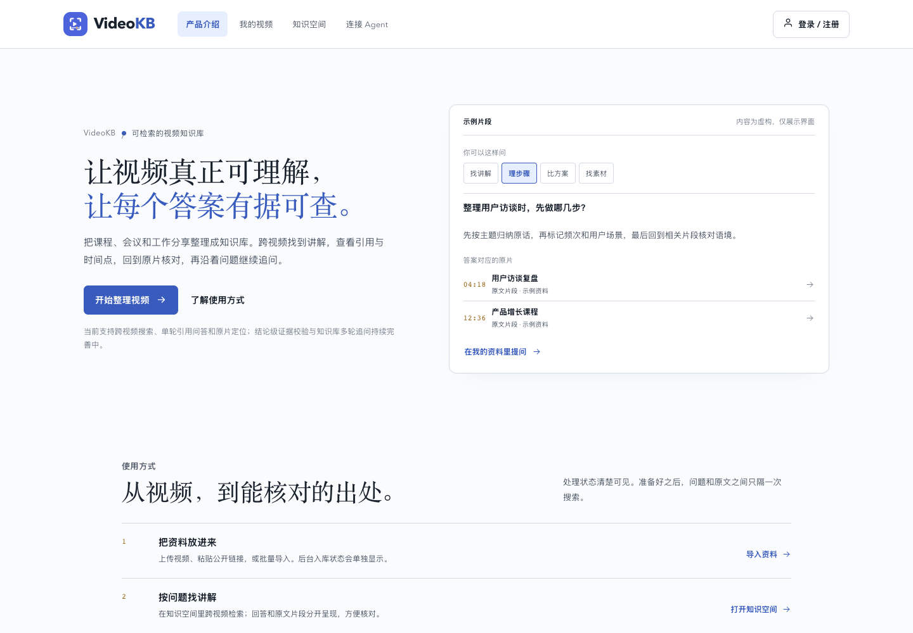
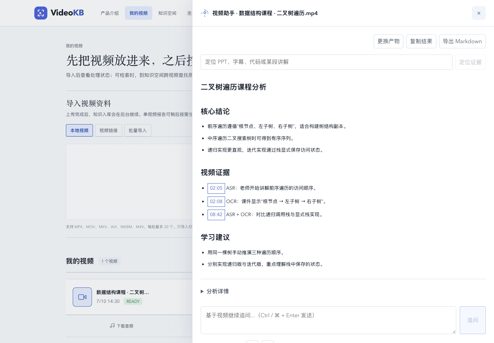

# VideoKB


> **让视频真正可理解，让每个答案有据可查。**
> 构建可检索、可追溯、可继续追问的视频知识库。

VideoKB 把课程、会议和工作分享整理成可搜索的知识库。你可以跨视频找到相关讲解，查看回答引用和时间点，回到原片核对，再沿着单段视频继续追问。我们的方向是让视频理解建立在原始内容与可回看的证据上，并持续完善结论级证据可信度校验。

## 产品界面

以下是当前蓝白风格产品前端的实际页面截图。截图通过内置演示模式生成，视频、回答和引用为示例数据，不代表真实用户资料或实时检索结果。

### 产品首页



### 视频分析、原文引用与继续追问



## VideoKB 能做什么

- **检索视频内容**：从已入库的视频中搜索讲解片段，支持跨视频查找。
- **查看出处**：回答附带来源和时间点，可以回到原视频核对上下文。
- **整理资料**：把视频放入知识空间和目录；同一份视频内容可以归入多个主题。
- **继续追问**：在单视频分析工作台围绕当前视频报告继续提问。
- **连接外部助手**：通过只读 MCP 工具搜索资料、提问和读取证据。

我们希望进一步做到：不仅找到相似片段，也能检查回答中的结论是否被原始视频证据支持。结论级证据可信度校验和跨视频多轮会话仍在建设中；引用片段存在不等于结论已经验证。

## 当前实现范围

| 能力 | 当前状态 |
| --- | --- |
| 跨视频检索 | 已支持；默认组合 Qdrant dense、MySQL LIKE 与 RRF |
| 引用与时间点回看 | 已支持；可查看来源并定位原片时间点 |
| 单轮引用问答 | 已支持；回答提供可核对的证据片段 |
| 知识空间与多目录引用 | 已支持；内容索引与目录归属分开管理 |
| 单视频分析与继续追问 | 工作台提供按需分析和围绕当前视频的追问 |
| 结论级证据可信度校验 | 尚未完成；逐字匹配不能替代语义支撑判断 |
| 跨视频持续多轮会话 | 尚未完成 |
| 多成员共享及独立 MCP 身份授权 | 尚未完成；MCP 客户端共用配置的上游账号 |

## 本地运行

服务端使用 Java 21 / Spring Boot，前端使用 Vue 3 / Vite。完整依赖与环境参数见 [`.env.example`](.env.example)。准备 JDK 21、Node.js、Docker Compose、FFmpeg 和 Tesseract 后，在项目根目录运行：

```bash
./scripts/dev-up.sh
```

默认前端地址为 `http://localhost:5173`，后端为 `9090`，MCP 为 `9091`。实际启动服务和所需密钥以本机配置及启动输出为准；未配置 `MCP_CLIENT_TOKENS` 时，启动脚本会跳过 MCP 服务。

## 技术栈

| 部分 | 技术 |
| --- | --- |
| Web 工作台 | Vue 3、Vite、SSE |
| 服务端 | Java 21、Spring Boot、MyBatis-Plus、LangChain4j |
| 异步任务与缓存 | RocketMQ、Redis、Redisson |
| 数据与媒体 | MySQL、MinIO |
| 检索 | Qdrant、MySQL；可选 Milvus BM25 词法召回 |
| 视频处理 | FFmpeg、Tesseract，以及项目配置的 ASR、文本和 embedding provider |

## 项目文档

- [项目文档总索引](docs/总索引.md)：架构、操作、专题资料和交付记录。
- [当前交付状态](docs/当前交付状态.md)：已实现能力、验证范围和未完成事项。
- [业务要求与验收契约](agent.md)：产品场景和业务约束。
- [系统架构与技术流程](docs/系统架构与技术流程.md)：入库、检索、问答、版本与失败边界。
- [使用与验收操作指南](docs/使用与验收操作指南.md)：本地体验路径。
- [MCP 外部助手接入指南](docs/外部助手接入指南.md)：只读工具与客户端配置。

## 当前交付说明

仓库包含生命周期、检索与界面等持续迭代工作。评测数据中的合成验收、真实语料结果和生产能力有明确边界；README 中的产品截图也是演示数据。部署前请查看[兼容与发布说明](docs/兼容与发布说明.md)，不要把本地通过等同于生产部署。

## License

[MIT](LICENSE)

浏览器扩展的安装与使用见[扩展说明](extension/README.md)。
