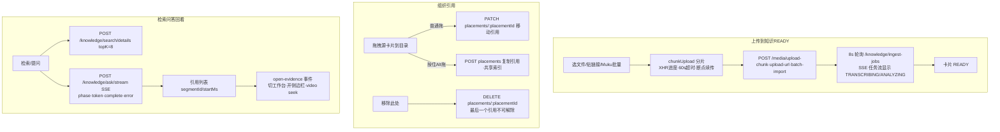

# client 组件知识卡

状态：`active`
最后复核：2026-10-19

接到 client（Vue 网页端）任务时先读本页。视觉与文案规范以 [client/DESIGN.md](../../client/DESIGN.md) 为准，业务验收见 [agent.md](../../agent.md)。

## 职责与边界

Vue 3.5（`<script setup>`）+ Vite（rolldown-vite 别名）单页应用，无路由库（hash 切换视图）、无 UI 组件库、无 TypeScript。承担：产品首页、我的视频工作台（上传/分析侧边栏）、知识空间（组织/入库状态/检索问答）、MCP 连接配置展示。文件即组件：`App.vue`（根壳+工作台）、`KnowledgeLibrary.vue`（知识空间）、`MukuBatchPanel.vue`（批量链接导入）、`components/ProductHome.vue` + `AppIcon.vue`。测试用 node:test（`node --test src/*.test.js`，5 个文件；本轮未运行）。

## 核心操作流

## 与后端的契约

全部经 `src/api.js`（Bearer `localStorage.authToken`，`{code,message,data}` 信封解包，401 清 token 派发 `auth-expired`）。分组：`/user`、`/media`（上传/列表/回看/批次）、`/analysis`（含 SSE 连接池 `taskEvents.js`，指数退避 ≤15s）、`/knowledge`（spaces/collections/sources/ingest-jobs/placements/search/ask）。`API_BASE = VITE_API_BASE_URL`（默认同源走 Vite 代理，代理只覆盖 6 个前缀）；MCP 面板 endpoint 为 `VITE_MCP_ENDPOINT || ${location.hostname}:9091/mcp`，仅 GET 探活。

**已知坑**：开发访问必须用 `localhost`（token 在 localStorage 依赖同源隔离、代理按 origin 转发）；`?demo` 演示模式只用于展示，静态示例不得冒充真实检索结果（DESIGN.md 内容红线）。

## 选型与约束（含被否方案）

| 决策 | 现行选择 | 为什么 / 被否方案 |
| --- | --- | --- |
| 视觉主题 | Cobalt Field Notes：纸白、细分隔线、钴蓝操作色与证据优先布局（DESIGN.md 2026-10-18） | 被否：发光渐变、虚构数据面板、重复卡片墙与空泛 AI 文案 |
| UI 方案 | 手写 CSS + `src/styles/` 分文件 | 被否：引入组件库（依赖面大、深定制成本高于手写） |
| 构建 | rolldown-vite 别名 | 尝新但保持 Vite 生态；`envDir: '..'` 读仓库根 .env |
| Markdown 渲染 | marked + 白名单（`markdown.js`/`videoTimestamps.js`，`[00:30]`→`#video-t=`） | 被否：直接 v-html（注入风险） |
| 测试 | node:test 与框架无关 | 与 extension 的测试选型一致，零依赖可跑 CI |
| 上传并发 | 单批 ≤20 超出标记跳过；Muku ≤100 条 | 防瞬时打爆消费端；批次状态存 localStorage 按用户隔离 |

**已知分歧**：client 已转浅色主题，extension 仍是旧暗色风格，两者尚未统一（见 [浏览器插件-extension.md](浏览器插件维护.md)）。

## 修改历史（git 摘要，提取日 2026-10-18）

- 2026-07-28~31：Agent 执行预算与修订恢复配套 UI（d643f6e 等）。
- 2026-09-17~19：知识库视图起步——目录/源管理（6b3debd）、产品切换器（fe56ce0）、标签（02cfbe5）、跨视频检索面板（c598ecd）、本地目录导入（3329651）。
- 2026-09-27/28：批量上传与自动派发（bc3e8db、97abe6d）、Finder 式拖拽归类与幽灵源修复（81965ef）、实时解析进度（37ce045）、批次末自动恢复失败源（9c6d1fc）。
- 2026-09-29/30：上传恢复与异步任务 UX 加固（98708e0）、任务隔离配套（a91e2b4）。
- 2026-10-08/09：随 PR#1/#3/#4/#5 联动（placement 语义、范围统一、证据展示）。
- 2026-10-18：产品首页、产品导航、浅色视觉体系、工作台与知识空间界面重构；以“原文定位框”统一替换导航、浏览器标签和安装图标的 Logo；本轮构建和手工端到端验收待补。
- 2026-10-18：Hallmark 视觉收敛；首页改为问题与出处示例、长文式说明和真实能力边界，工作台移除重复三步卡片与发光装饰；新增共享 OKLCH 色彩、字体、间距 token。仅调整呈现，原有业务操作保留；生产构建成功，未运行自动化测试；浏览器已查看首页桌面视口，登录后的工作台与知识空间尚未手工验收。
- 2026-10-19：首页产品介绍与 README 对齐为“让视频真正可理解，让每个答案有据可查”；说明跨视频检索、引用定位与单视频追问的当前范围，并把结论级证据校验、多轮会话标为持续建设。README 使用蓝白产品首页及工作台实拍，截图内容来自内置演示模式并已标注。未调整业务能力。

合并 PR 时在本节追加一行。

## 待办（见活跃队列）

[待办事项](../待办事项.md)：BR-02 匹配路径展示与真实课程回归、BR-05 连续追问交互（现仅单轮流式）、产品化评审落地项（[Agent 知识库产品化评审](智能体知识库产品化评审-2026-10-14.md)、[学生 PRD](学生视频知识库需求-2026-10-15.md)）。

## 文字版端到端测试案例

1. **引用不重解析**：把一个 READY 源 Alt 拖进第二个目录，两个目录都能检出同一片段；删除其中一个引用，另一目录检索不受影响；全程无新的 ingest job 产生。
2. **失败可见可重试**：制造一个 FAILED 源（如损坏文件），卡片应显示失败原因且提供重试入口，重试后状态流转可见，无静默死状态。
3. **时间戳回看闭环**：问答答案点击某条引用，应切回工作台、打开侧边栏并 seek 到对应时间点，视频为该引用的 mediaId。
4. **演示模式红线**：`?demo` 下首页静态示例必须带"静态示例"标注，不出现虚构指标或冒充真实结果。
5. **链接导入失败提示（待手工验收）**：导入一个需要平台登录验证的 URL，页面应显示服务端可操作的错误提示，不能把失败源显示为 READY；随后改用本地文件上传，流程应可重新受理。公开可下载链接仍能进入正常任务流。
6. **Logo 小尺寸识别**：导航、浏览器标签、iOS/Android 安装图标使用相同的“取景框 + 播放 + 时间标记”图形；在 24px 和 192px 下主体轮廓清楚，浅色界面中无白边或模糊。
7. **Hallmark 响应式布局**：首页示例、工作台导入与知识空间在 320、375、414、768px 下不产生页面横向滚动；点击标签不折成两行，示例出处仍可读且可操作。
8. **Hallmark 能力边界**：首页示例持续标注为虚构内容；上传中、知识入库和报告状态没有被合并成一个“完成”状态，Agent 文案仍说明 MCP 只读检索与共享上游账号边界。
