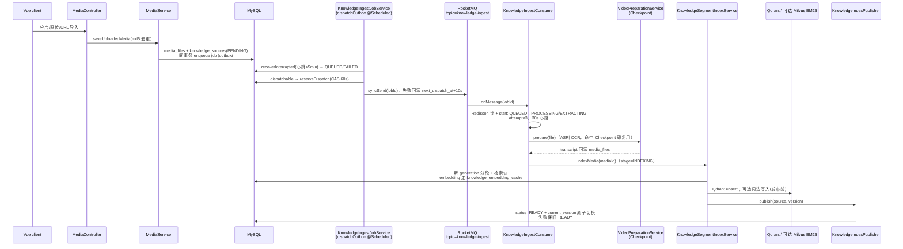
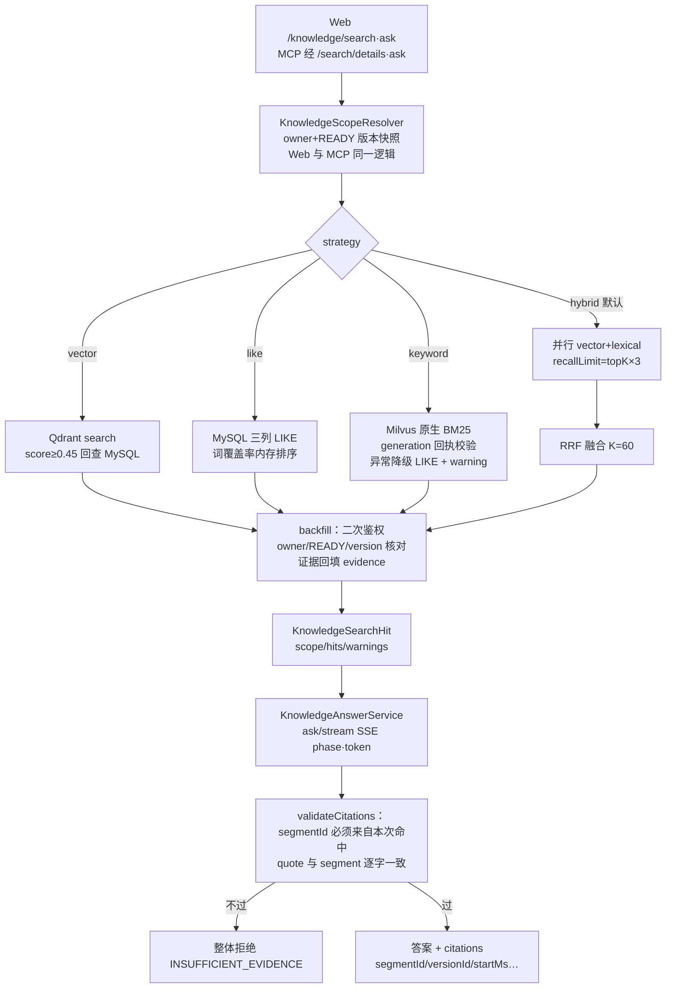
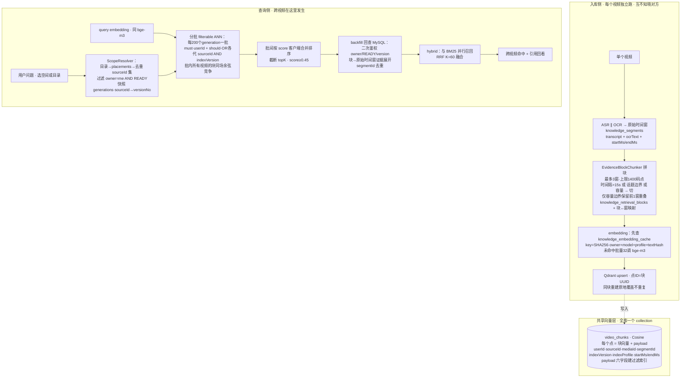

# server 组件知识卡

状态：`active`
最后复核：2026-10-18

接到 server（Java 后端）任务时先读本页。业务验收标准见 [agent.md](../../agent.md)；全局数据流与模块边界见 [当前后端架构](../系统架构与技术流程.md)，本页不重复。

## 职责与边界

Spring Boot 3 / Java 21 单体（`com.example.server`），承担：媒体接收与去重、知识任务受理与可靠投递（outbox + RocketMQ）、ASR/OCR 提取与 Checkpoint 复用、分段/embedding/向量与词法写入、generation 原子发布、授权范围检索与单轮流式问答。报告分析（AgentLoop）是并行的一条消费链路（`video-analysis-topic`），与知识入库解耦。

scripts/（dev-up、架构 fixture、benchmark runtime 等）与 infra/ 的入口在本页"运行"一节。

## 入库生命周期（时序）

状态机：state ∈ QUEUED/PROCESSING/READY/FAILED/CANCELLED；stage ∈ QUEUED/EXTRACTING/INDEXING/RECOVERING/READY/FAILED/CANCELLED。`force_rebuild` 区分用户显式重建与重复投递；已 READY 的普通重复消息直接跳过。旧转写导入（`import-transcript`）不经 MQ 直接复用同一索引服务。

URL 导入在持久知识任务前经过 `YtDlpUtils`。本轮代码把 yt-dlp 非零退出分类为“平台登录验证”或“来源不可用”，可配置下载超时，`ApiExceptionHandler` 映射为 503 并返回改用本地上传/检查公开访问的提示；该分支不应污染后续入库 READY。分类只用于用户提示，不能据此推断平台链接一定永久失效；相关测试源码尚未在本轮运行。

## 检索与问答链路

## 向量化与跨视频检索（数据视角）

跨视频不是建库时的"合并"动作：每个视频独立入库、互不知晓对方，全部写入**同一个 Qdrant collection**；跨视频发生在查询时——scope 解析出参与检索的 (source, version) 集合，向量检索在这个集合上做服务端过滤 ANN，不同视频的块在同一向量空间按余弦相似度统一竞争。

要点（源码级）：

- **块的语义**（`EvidenceBlockChunker`，profile `raw-boundary-v1-max1400-overlap1`）：块=最多 3 个连续原始时间窗拼接、上限 1400 码点；切界三条件任一触发——时间窗间隔 >15s、话题边界（开头 80 字匹配"接下来/下面我们/再来看/换一个问题"或 bigram 相似度 <0.06）、容量超限；"overlap1"仅指容量边界时保留前 1 窗进下一块，话题与时间边界永不跨。块只做检索，证据永远展开回原始时间窗。
- **embedding 缓存**（`KnowledgeBlockIndexService.cacheKey`）：SHA-256(owner + model + profile + textHash)，不含 sourceId——同 owner 下相同文本（重解析、目录引用、同视频重复）不重复调模型。
- **点的身份与清理**：点 ID=块 UUID（重建原地覆盖）；`deleteSource(sourceId)` 按 payload 清一个来源的全部点；`updateSourceLocation` 重刷 spaceId/collectionId 投影（旧空间过滤路径用，generation 路径不依赖）。
- **分批合并**（`QdrantVectorStore.search(vector, scope, limit)`）：每 200 个 generation 一批构造 must(userId) + should(OR 各代 sourceId∧indexVersion) 的 filter，每批各取 limit 后客户端按 score 全局排序截断——分批只为 HTTP filter 有界，不是按视频隔离。
- **版本快照**：payload 带 indexVersion，查询锁定 generations 快照，发布/重建期间不命中未发布或旧版本；这是 BR-03"失败保旧 READY"在向量层的实现。
- 入口：[EvidenceBlockChunker](../../server/src/main/java/com/example/server/service/EvidenceBlockChunker.java)、[KnowledgeBlockIndexService](../../server/src/main/java/com/example/server/service/KnowledgeBlockIndexService.java)、[QdrantVectorStore](../../server/src/main/java/com/example/server/service/QdrantVectorStore.java)、[KnowledgeScopeResolver](../../server/src/main/java/com/example/server/service/KnowledgeScopeResolver.java)。

## 选型与约束（含被否方案）

| 决策 | 现行选择 | 为什么 / 被否方案 |
| --- | --- | --- |
| 消息中间件 | RocketMQ，知识入库独立 topic/consumerGroup | 知识队列与报告分析队列隔离，避免报告流量拖垮入库；被否：单队列混跑（09-28 断连事故后的修复方向） |
| 入库可靠性 | job 表兼任 outbox，事务后投递 + CAS 预约 + 心跳恢复 | 被否：报告驱动入库（report-dependent ingest）——AGENTS.md 明确禁止回潮；被否：先删旧索引再建（目录 CHANGED 旧路径遗留，非安全替换） |
| 发布语义 | generation 原子发布，失败保旧 READY | 被否：原地覆盖分段/向量（无法回退） |
| 向量库 | Qdrant 过渡；Milvus 为 2026-10-09 指定的后续优先栈 | 切换门禁：同条件对照、双写回灌、授权/版本对账、影子查询、恢复验证；未过门禁不得切默认 |
| 词法检索 | 默认 MySQL LIKE，Milvus 原生 BM25 需显式启用 | BM25 通道已有回执对账与整路降级 warnings；保留 LIKE 基线是为了已验证行为不被未验证路径替换 |
| 检索块 | 原文与检索块分离（profile `raw-boundary-v1-max1400-overlap1`） | 检索用块、证据回原文，防摘要污染；legacy-v1 仅对照保留 |
| 引用校验 | 逐字一致 + segmentId 白名单 | 被否：字符串存在即算数（不能证明结论正确）；结论语义校验仍是缺口 |
| ASR | SiliconFlow 网关，模型经环境变量 | TeleSpeechASR 已下架，2026-09-28 换免费 XingChenASR-V3.2；ASR/LLM/embedding 复用同一网关与 key |
| Web 容器 | Undertow 替换 Tomcat | pom 显式替换 |
| ORM/迁移 | MyBatis-Plus + Flyway（V1~V12） | 注解 SQL 承担状态机 CAS 语义，改动需对照 Mapper |

配置文件是 `src/main/resources/application.properties`（不是 yml），环境变量覆盖；端口 9090，CORS 白名单 5173/5174。

Milvus 专项读写图、故障降级与目标迁移门槛集中在 [Milvus 架构与迁移边界](向量库架构与迁移边界.md)；本卡只保留 server 视角，避免两处维护细节。

## 运行（scripts/infra 归并）

`scripts/dev-up.sh` 一键起本地依赖；`scripts/architecture-fixture.sh` + `evidence-benchmark-runtime.sh`（19092 端口、独立 Redis DB12、关 outbox 投递）供隔离验收；`scripts/milvus-benchmark-runtime.sh`（Milvus 19531）。详见 [评测体系-eval.md](评测体系维护.md) 的 runtime 一节。

## 修改历史（git 摘要，提取日 2026-10-18）

- 2026-07-28~31：执行预算加固、本地部署一键脚本（a509262、d643f6e、df23f36）。
- 2026-09-27 d56fd7e：knowledge baseline——ask 栈、任务台账 V8、mcp-server 模块、Vue KB UI；同日零重烧转写导入（6e937d8）、逐字引用校验（6df640d、973419c）。
- 2026-09-28 事故修复日：索引先行/诚实投递/READY 不连坐（13836f7、06f3e4b）、批次恢复与实时进度（9c6d1fc、37ce045）、批次上传自动派发（bc3e8db、97abe6d）、TeleSpeechASR 下架替换（9819a37）。
- 2026-09-29/30：上传去重（2e870ec）、分片与入库韧性（46ed743）、任务隔离与陈旧状态（a91e2b4）。
- 2026-10-08 afdde54：持久任务/placement/generation 发布三分离（PR#1 合入）；同日真实语料证据基准冻结（133b175）、Web/MCP 查询范围统一（a3b7d94，PR#3）。
- 2026-10-09 93bd750（PR#4）：原文证据与 profiled 检索块；cb939bd：范围化 Milvus BM25 词法与降级诊断。
- 2026-10-18：yt-dlp 下载错误分类、可配置超时与 503 用户提示；对应 `YtDlpUtilsTest`、`ApiExceptionHandlerTest`。本轮测试与真实视频回归待运行。

合并 PR 时在本节追加一行，不重写旧记录。

## 待办（不自建状态，见活跃队列）

[待办事项](../待办事项.md) 中与本组件相关的方向：BR-01 真实长任务与 MQ 停机恢复专项、BR-03 目录 CHANGED 安全替换与旧 generation 清理、BR-04 reranker 与跨视频关键题、BR-05 多轮会话、BR-06 结论语义校验。

## 文字版端到端测试案例

执行者自备环境（dev-up + 一个真实小视频），按描述验收，结果记入报告而非本页：

1. **断电续跑**：上传一个 10 分钟以上视频，在 EXTRACTING 阶段强杀 server 进程，重启后 job 应从 Checkpoint 恢复（不重跑已提取部分），最终 READY；若 attempt≥3 应 FAILED 且页面可见失败原因与重试入口。
2. **发布失败保护**：让 Qdrant 在 INDEXING 阶段不可用，本次构建应失败且旧 READY 版本仍可检索；恢复 Qdrant 后重试成功，current_version 指向新版本。
3. **降级可见**：启用 Milvus 词法后停掉 Milvus，hybrid 检索应返回结果并带 BM25 降级 warning；完全停掉 Qdrant 时 vector 通道为空但 LIKE 结果仍在。
4. **越权隔离**：用户 B 用用户 A 的 sourceId 显式查目录，返回应为空而非命中；删除 source 后旧 versionId 读取被拒绝。
5. **引用拒答**：构造一个模型容易泛答的域外问题，答案应为固定拒答话术（INSUFFICIENT_EVIDENCE）而非编造引用。
6. **视频链接受限（待手工验收）**：给媒体 URL 导入一个需要平台登录验证的链接，应收到 503 与改用本地上传的提示，响应不含 yt-dlp 原始日志或凭据；同一用户改用本地文件后可继续受理并进入知识任务。另用公开可下载链接确认正常路径未退化。
