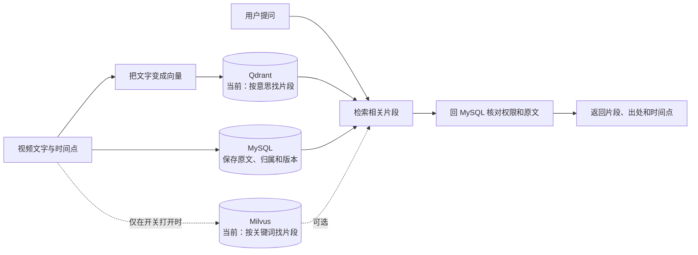
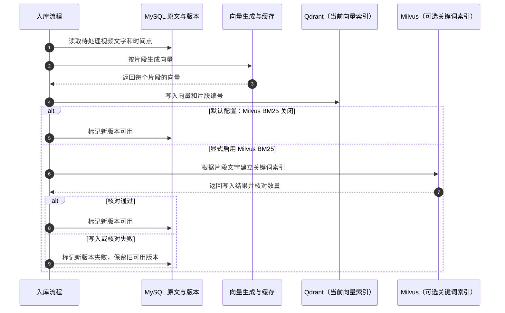
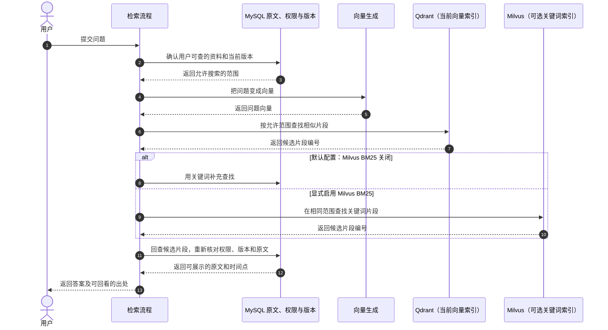
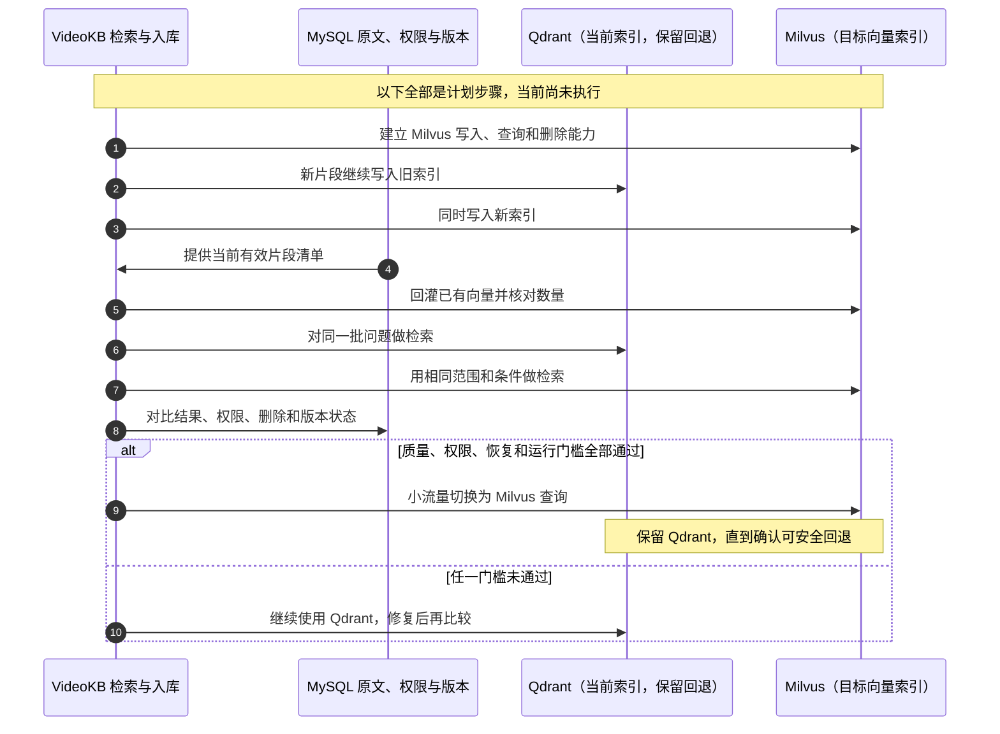

# Milvus 架构与迁移边界

状态：`active`  
最后复核：2026-10-19

本页先用**概念图和时序图**解释向量知识库怎样工作，再给出对应代码位置。这里不画 Milvus 产品内部集群，也不把类名当作架构层。当前状态：问题向量仍在 Qdrant 检索；Milvus 只用于可选的关键词索引；默认关键词通道是 MySQL。完整迁移方向已确认但尚未实施。具体状态见[当前交付状态](../当前交付状态.md)，实验数字见[词法召回报告](词法召回与对照-2026-10-09.md)。

## 先看懂这张图：谁负责什么



可以把向量库理解为“候选片段目录”：它帮系统快速找到可能相关的片段，但不保存最终可信答案，也不决定用户有没有权限。原文、用户归属、目录和版本仍以 MySQL 为准；系统拿到候选后会回 MySQL 核对，再返回原文和时间点。

## 时序一：视频入库时，片段怎样进入索引

下面画的是当前流程。默认写 Qdrant；如果显式打开 Milvus BM25，还会多写一份关键词索引。只有需要的索引都写入并核对成功后，新版本才会发布。



## 时序二：用户提问时，答案怎样找到可核对的出处



如果 Milvus 关键词索引没启用、数据未准备好或服务出错，当前实现会退回 MySQL 关键词检索并给出提示。无论候选来自哪个索引，最后都要回 MySQL 核对权限、版本和原文。

## 建议阅读顺序：只看向量知识库

1. 先看本页架构图和下方迁移边界，掌握现状、BM25 可选路径与尚未迁移的部分。
2. 看 [KnowledgeSegmentIndexService](../../server/src/main/java/com/example/server/service/KnowledgeSegmentIndexService.java)，了解 generation 编排、写入顺序和什么时候发布新版本；再看 [KnowledgeBlockIndexService](../../server/src/main/java/com/example/server/service/KnowledgeBlockIndexService.java)，了解当前检索块如何生成向量并写入。
3. 看 [QdrantVectorStore](../../server/src/main/java/com/example/server/service/QdrantVectorStore.java) 和 [KnowledgeVectorIndex](../../server/src/main/java/com/example/server/service/KnowledgeVectorIndex.java)，确认 Qdrant 具体读写实现，以及抽象目前只覆盖查询。
4. 看 [KnowledgeSearchService](../../server/src/main/java/com/example/server/service/KnowledgeSearchService.java)，跟一遍 query embedding、dense/词法召回、RRF 和降级；再看 [KnowledgeScopeResolver](../../server/src/main/java/com/example/server/service/KnowledgeScopeResolver.java) 与 [KnowledgeLexicalIndexService](../../server/src/main/java/com/example/server/service/KnowledgeLexicalIndexService.java) 核对权限范围和 Milvus 回执检查。
5. 最后看 [MilvusLexicalClient](../../server/src/main/java/com/example/server/service/MilvusLexicalClient.java)、[配置开关](../../server/src/main/resources/application.properties) 和 [词法召回对照报告](词法召回与对照-2026-10-09.md)，判断 BM25 实际如何启用、效果证据有多大。

不要从 Milvus 官方产品内部架构图推断本项目部署形态；这里的代码目前只把 Milvus 用作可选 BM25 词法索引。

## 已完成的范围与证据

| 层 | 已完成 | 证据边界 |
| --- | --- | --- |
| Milvus 词法索引 | REST v2 collection 校验、`jieba`/`lowercase`、BM25 sparse 索引、按当前 generation 写入与回执 | [实机冒烟](../../eval/reports/milvus-bm25-smoke-20261009.json)在隔离环境验证；不是生产 HA |
| 查询 | 显式启用的 BM25、完整性检查、同范围过滤、缺失/故障整路降级、Web/MCP warning | [真实开发集对照](../../eval/reports/milvus-bm25-dev-20261009.json)、[Web](../../eval/reports/milvus-bm25-ui-20261009.json)、[MCP](../../eval/reports/milvus-bm25-mcp-20261009.json)；不是多主体 MCP |
| 默认路径 | Qdrant dense + MySQL LIKE + RRF | Milvus 未启用时仍可运行；保留 Qdrant 数据 |

冻结开发集显示 BM25 词法优于旧 LIKE，但 dense + BM25 的 RRF 低于同组 dense。这证明词法通道有增益，不能证明完整问答正确率、Milvus dense 性能或生产容量。数字、指标定义与限制只在 [词法报告](词法召回与对照-2026-10-09.md) 维护。

## 时序三：将来从 Qdrant 切换到 Milvus（尚未实施）



这张时序图表达的是迁移顺序，不代表现在已经双写或切流。当前代码还没有 Milvus 向量写入适配器；现有 `KnowledgeVectorIndex` 只抽象查询，写入和删除仍绑定 Qdrant。门槛、迁移原因和过程记录见[向量数据库迁移决策与过程记录](向量数据库迁移决策与过程记录.md)。

## 本地启动与验证

```bash
# 仓库根执行；嵌入式 etcd + 本地存储单容器，无需外部 etcd/MinIO/api-key
docker compose -p video-kb-milvus-experiment -f docker-compose.milvus.yml up -d
curl http://127.0.0.1:19093/healthz                                   # 健康（映射 9091）
curl -X POST http://127.0.0.1:19531/v2/vectordb/collections/list \
  -H "Content-Type: application/json" -d '{}'                          # REST v2 入口
```

2026-10-17 实测（M1/11.7G Docker）：启动约 20 秒 healthy，稳态约 158MB 内存；create/insert/search REST v2 跑通。"Milvus 重"指的是分布式集群形态（Proxy/QueryNode/DataNode 分离 + 独立 etcd + 对象存储），standalone 实验形态很轻。启用项目 BM25 词法的全部配置见 `scripts/milvus-benchmark-runtime.sh`（`knowledge.lexical.milvus.enabled=true` + url + collection 三个键），不动 Qdrant 与产品数据。停用：`docker compose -p video-kb-milvus-experiment -f docker-compose.milvus.yml down`（加 `-v` 连实验卷一起清）。

## AI 修改时的核对案例

1. 启用 BM25 后重建来源：Milvus 写入或 count 失败，当前 READY 版本仍可查，新版本不得发布。
2. 当前范围中任一 generation 缺回执、文档丢失或 Milvus 停机：整路词法回退 LIKE，`search/details`、Web、MCP 都保留 warning；不能悄悄把部分 BM25 命中当完整结果。
3. 同一来源在两个目录、另一用户请求、删除引用与发布新版本期间：Milvus 过滤和 SQL 回填都必须遵守同一 owner/source/version 范围。
4. 比较 dense 库时：先固定词法与 RRF，分别记录必要证据覆盖、带过滤 P95、写入/删除可见性、资源与故障恢复；不得用 BM25 对 LIKE 的改进宣称 Milvus dense 优于 Qdrant。
