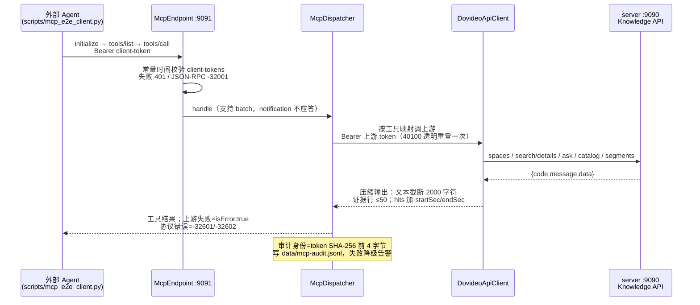

# mcp-server 组件知识卡

状态：`active`
最后复核：2026-10-15

接到 mcp-server（MCP 适配器）任务时先读本页。工具操作契约见 [MCP SOP](../外部助手接入指南.md)，验收要求见 agent.md BR-07。

## 职责与边界

独立 Spring Boot 3.5.9 / Java 21 进程（端口 9091），把外部 Agent 的 MCP 调用转发到 server（9090）的 Knowledge API。仅 7 个类：`McpEndpoint`（`POST /mcp` 唯一入口）、`McpDispatcher`（手写 JSON-RPC 2.0）、`DovideoApiClient`（上游 HTTP 客户端）、`McpAuditWriter`（JSONL 审计）等。

## 请求流转

五个只读工具与上游映射：`list_knowledge_spaces`→GET /knowledge/spaces；`search_video_knowledge`→POST /knowledge/search/details（query 必填，topK 1-20 默认 5，strategy 默认 hybrid）；`ask_video_knowledge`→POST /knowledge/ask；`get_knowledge_catalog`→GET /knowledge/spaces/{id}/catalog；`get_video_evidence`→GET /knowledge/sources/media/{mediaId}/segments（可带 versionId 读历史版本）。

## 选型与约束（含被否方案）

| 决策 | 现行选择 | 为什么 / 被否方案 |
| --- | --- | --- |
| 协议实现 | 手写 JSON-RPC 分发，MCP Streamable HTTP 无状态子集 | 被否：官方 MCP Java SDK——依赖重且当时只需无状态子集；支持三个协议版本（2024-11-05/2025-03-26/2025-06-18），GET/DELETE 明确 405 |
| 信任边界 | 两层：客户端 token（多个）→ 共用一个上游账号 | 多客户端 ≠ 多用户；社区成员隔离未实现（BR-07 剩余项），不得宣称已支持 |
| token 校验 | `MessageDigest.isEqual` 常量时间比较；审计只存 token 哈希前缀 | 防时序侧信道与明文泄漏 |
| 输出压缩 | 文本 2000 字符/证据 50 行截断 | LLM 上下文卫生；截断在适配层做，server 返回完整数据 |
| 上游鉴权 | 静态 token 或账号密码登录缓存，40100 自动重登 | 会话过期对 Agent 透明 |
| 审计 | 追加 JSONL，写失败降级告警不阻断调用 | 审计可用性不得高于工具可用性 |

## 修改历史（git 摘要，提取日 2026-10-15）

- 2026-09-27 d56fd7e：模块创建（baseline 一部分）；70e2e8d：ask_video_knowledge 工具 + 服务账号鉴权修复；414271b：构建产物与审计数据 gitignore。
- 2026-10-08 afdde54 / a3b7d94（PR#3）：与 server 查询范围统一，目录/就绪状态语义对齐。
- 2026-10-09 93bd750（PR#4）：证据工具支持 versionId 历史版本。

合并 PR 时在本节追加一行。

## 待办（见活跃队列）

BR-07：多人开放前的主体与空间绑定；默认范围差异说明维护（省略 spaceId 时由后端选默认空间）；MCP SOP 样本更新。

## 文字版端到端测试案例

1. **范围一致性**：同一问题分别走 Web `/knowledge/search/details` 与 MCP `search_video_knowledge`（同用户同空间），hits 与 scope 应一致（时序字段别名差异除外）。
2. **错误语义分离**：调一个不存在的工具名应返回协议错误（-32601）；上游 server 停机时工具调用应返回 `isError:true` 的工具结果而非协议错误。
3. **未就绪可见**：对只有 PENDING 源的空间调 catalog/search，应返回引用与入库状态而非当作无数据；拒答/降级 warning 原样透传。
4. **token 边界**：无/错 client-token 请求 401；审计文件中出现 `client-xxxx` 身份而非明文 token。
