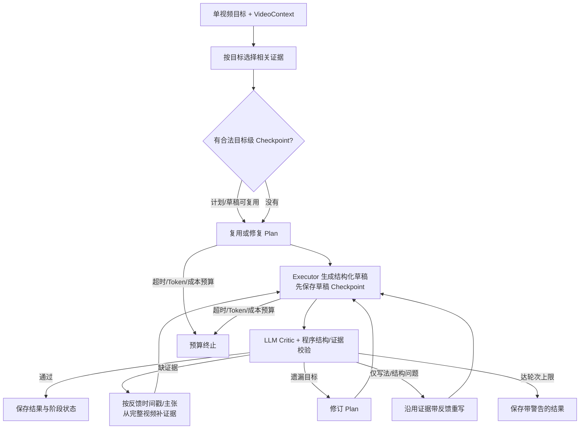

# 单视频 Agent 工作流知识卡

状态：`active`  
最后复核：2026-10-16

本卡覆盖 `server` 内的单视频报告分析子系统。跨视频知识库的检索/问答见 [server 知识卡](后端服务维护.md)，外部 Agent 的工具协议见 [mcp-server 知识卡](外部助手适配器维护.md)。三者复用视频证据，但不是同一个运行循环。

## 职责与流程

`AgentLoopService` 在一个 `mediaId` 和用户目标范围内运行受控的 Planner → Executor → Critic。`VideoEvidenceRetrievalService` 与 `LongVideoContextService` 选择/补充证据；模型调用由 `DeepSeekUtils` 发起，程序负责轮次、预算、Checkpoint、结构和证据边界。报告分析走 `video-analysis-topic`，知识入库走独立队列；报告失败不应撤销已发布的知识来源。

MQ 重试时，已有 Executor 草稿可从 Critic 继续；目标级键包含 `mediaId`、目标摘要和模式，视频上下文是内容级 Checkpoint。这是**任务恢复**，不是跨轮聊天记忆。默认最大 2 轮；预算上限由 `application.properties` 配置。超过轮次仍可能保留带 Critic 警告的结果；预算终止是另一种状态。实际用户界面、错误处理和验收以 [当前交付状态](../当前交付状态.md) 与 [体验 SOP](../使用与验收操作指南.md) 为准。

## 选型与约束

| 取舍 | 现在为何这样做 | 不能据此宣称 |
| --- | --- | --- |
| 程序控制三阶段，模型分别承担计划、草稿、评论 | 轮次、失败原因与重试路径可观察；`MAX_PLAN_TASKS=5` 限制计划规模 | 三个独立自治 Agent 或 A2A 协作 |
| 先保存草稿再 Critic，按目标/模式隔离 Checkpoint | MQ 重投不必每次重跑完整生成；避免不同目标/模式互相污染 | 已实现跨会话长期记忆或多轮问答 |
| Critic 反馈分类为补证、补计划或重写 | 失败后确实改变后续输入，避免无意义重复生成 | LLM Critic 的“通过”能证明每条结论语义正确 |
| 程序校验结构、时间戳和原始 ASR/OCR 证据 | 拦截缺字段与伪造/错位引用 | 已完成形式化的结论蕴含证明 |
| 有界预算与阶段事件 | 超时/估算 Token/成本和最大轮次可终止执行 | 无限自治探索或已验证的生产成本上限 |

核心代码：[AgentLoopService](../../server/src/main/java/com/example/server/service/AgentLoopService.java)、[Checkpoint](../../server/src/main/java/com/example/server/service/AgentCheckpointService.java)、[证据检索](../../server/src/main/java/com/example/server/service/VideoEvidenceRetrievalService.java)、[证据核验](../../server/src/main/java/com/example/server/service/EvidenceVerificationService.java)、[预算](../../server/src/main/java/com/example/server/service/AgentExecutionBudget.java)。跨视频 `/knowledge/ask` 是一次授权 RAG 问答，不进入这个 Planner/Executor/Critic 循环；MCP 只把知识 API 暴露给外部 Agent。

## 修改历史（git 摘要，提取日 2026-10-16）

- 2026-07-28 `d643f6e`：执行预算、修订恢复与证据校验加固。
- 2026-09-18 `0bef17b`：预算时长至少覆盖 Planner/Executor/Critic 各一次调用。
- 2026-09-28 `36b3a2f`：追问记忆隔离与工具预算约束。
- 2026-09-30 `a91e2b4`：分析任务隔离和陈旧工作流状态修复。

新 PR 合并后补真实提交/PR 与行为变化，不把候选方案写进已实现历史。

## 待办与文字验收案例

待推进的业务验收仍以 [待办事项](../待办事项.md) 为准；本卡不另排优先级。当前跨视频多轮会话、开放式工具规划、独立多 Agent 协作、claim 语义级支持评估均未因这个单视频工作流而完成。

1. **草稿后重启**：在 Executor 草稿 Checkpoint 写入后中断消费，重试应从 Critic 继续；结果不重复生成，且阶段事件可见。
2. **证据缺口修订**：给 Critic 提供 `unsupportedClaims` 或 `requiredTimestamps`，下一轮应从完整视频补充相应证据；只有结构反馈时应沿用已选证据重写。
3. **目标/模式隔离**：同一视频分别提交两个目标或不同模式，读取各自计划和结果，不相互覆盖；内容级 ASR/OCR 上下文仍可复用。
4. **预算与上限**：让模型调用超时或连续两轮不通过，应分别进入预算终止或带警告结果，不能无限循环、静默标记完全通过。
5. **边界识别**：跨视频 `/knowledge/ask` 与 MCP 工具调用不应读取单视频 Agent 的目标级 Checkpoint 作为聊天历史，也不能把外部 Agent 的记忆作为视频原文引用。

这些是可执行的验收描述；运行结果须进入版本化报告，未运行不等于已通过。
