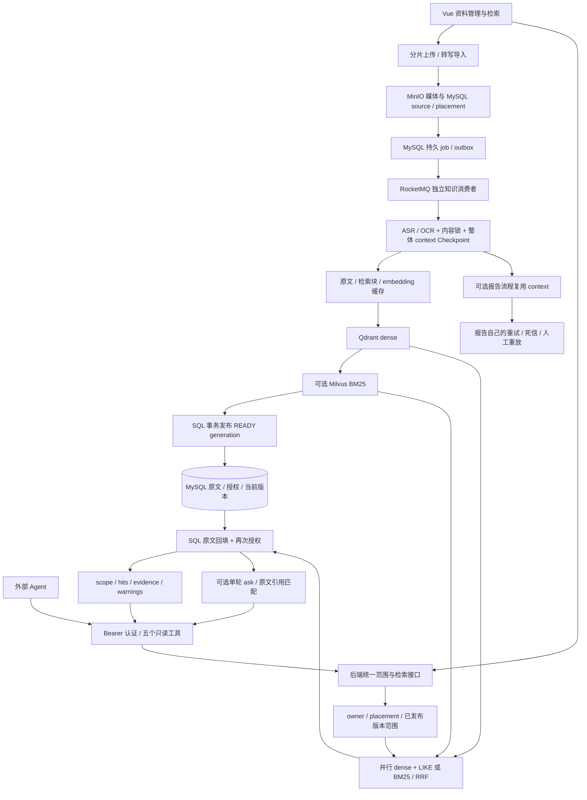
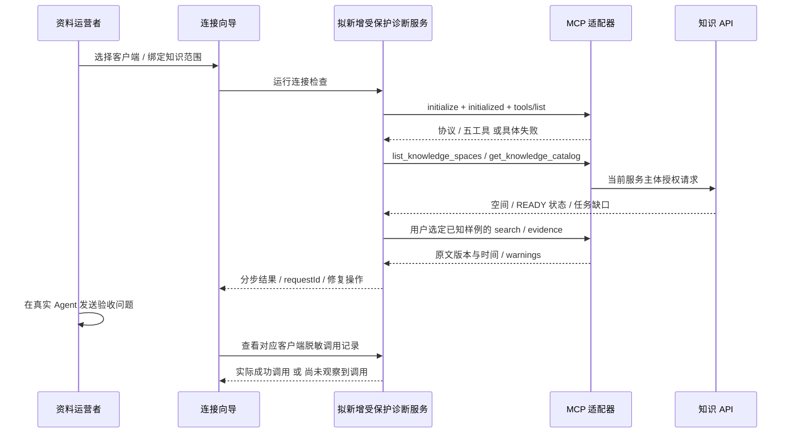
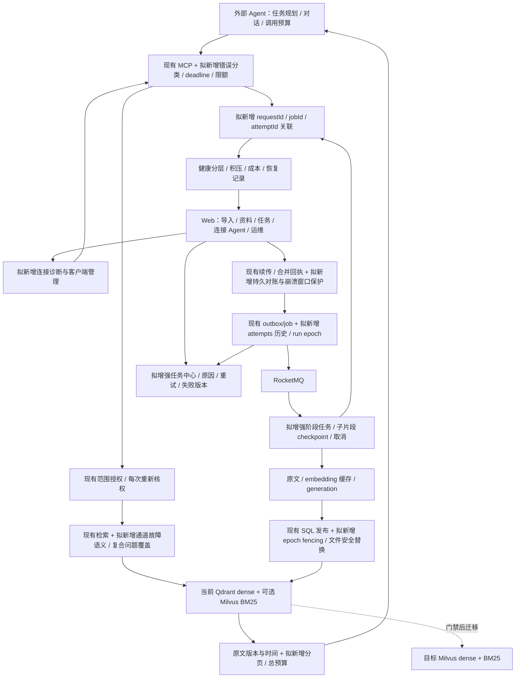

# Agent 视频知识库：架构评审与产品化规划

状态：`draft`
最后复核：2026-10-14

本次负责人要求：让子 Agent 作为架构面试官评判项目，规划 Agent 接入、失败处理、视频重试和易用产品形态。本文是源码审查和建议方案，不是新增能力的验收结果；阶段顺序供负责人审阅，不改写既有批准排期。业务事实仍以 [agent.md](../../agent.md)、[当前交付状态](../当前交付状态.md)、[活跃队列](../待办事项.md)为准。

[交互架构图与缺口看板](智能体知识库架构规划-2026-10-14.html)提供当前/目标切换和模块详情；图是本文的可视化摘要，不连接真实服务、不执行重试、不采集凭据。

## 1. 架构员的判定

已有实现具备个人视频知识库和只读 MCP 的工程基础，能够支撑面试深挖；尚不满足“接入即可用、错误可解释、失败可恢复、真实 Agent 任务可证明”的产品交付门槛。不能把握手成功当业务可用，也不能把已有重试写成完全没有重试。

- 当前明确目标：外部 Agent 是知识消费方；Web 承担资料导入、组织、诊断和原片回看。Agent 管理自己对话和检索规划，知识服务每次重新授权和返回可核验证据。
- 首版建议：一个运营者管理资料、多个受信 Agent 使用同一授权知识范围；继续五个只读 MCP 工具。多用户各自私有知识库的开放服务是后续独立门槛，并非当前多个 token 已具备的能力。
- Milvus 是后续优先栈。当前默认 Qdrant dense + LIKE + RRF；显式启用时为 Qdrant dense + Milvus BM25。dense 迁移、双写/影子查询未完成，旧 Qdrant 数据保留。
- 本评审主要证据是当前源码和 10 月 7–9 日保存的测试/实测；没有本次真实 Agent 运行、生产性能或用户研究结论。子 Agent 独立评审以审查意见呈现，不当作独立运行测试。

独立子 Agent“架构面试官”的结论：这是有实质工程深度的个人视频知识库原型，尚未达到普通用户接入 Agent 后能自行发现并处理故障的易用产品。其独立核查与主审在接入绿点局限、MCP 错误契约、知识/报告重试分离、子片段恢复、旧 worker 隔离风险及真实 Agent 验收缺口上结论一致；具体问题与门禁合并在下文，避免另建重复事实清单。

## 2. 当前架构：已实现的边界

实线为现有调用；Milvus 是可选词法通道。MySQL 当前版本指针是可见性边界，向量索引本身不授予可见性。

知识入库的三次尝试由 DB job 管理；报告分析的死信属于另一条流程。默认关闭 BM25 时，dense 写完直接发布，不经过 Milvus。目录 CHANGED 替换当前仍先删除旧资产，不能套用索引重建的旧版保留结论。

## 3. 已准备什么，还差什么

| 问题 | 当前事实与证据等级 | 产品缺口 |
| --- | --- | --- |
| 是否接入成功 | Vue 已有端点/配置复制；GET 有任何可读响应即亮在线；HTTP 握手/五工具已有隔离测试 | 改为分层诊断，认证、握手、工具清单、授权空间、已就绪语料、真实检索分别展示 |
| 上游会话过期 | 账号模式遇 40100 重登录并重试一次；静态 token 不刷新 | 并发刷新合并、过期/凭据错误可解释，令牌管理与撤销体验 |
| 工具网络失败 | 10s 连接、60s 单请求、15s 登录超时；失败 isError + 文本 | 分类错误、requestId、总 deadline、可重试提示、有限退避、熔断/限额；HTTP 非 JSON 故障也可诊断 |
| 上传断网 | 5MiB 分片、并发 3、最多 4 次尝试、退避抖动、按账号续传凭据；后端合并锁和 25h Redis 完成回执已有 | 服务重启/响应丢失的真实验收；数据库保存后而 Redis 回执落地前的崩溃窗口与持久对账；边界与配额清楚展示 |
| 入库失败 | 持久 job、DB 抢占、最多 3 次、失败后 30s 调度、30s 心跳、5min 失联恢复；Vue 展示原因和重新解析 | 错误分类、按阶段重试、失败中心、人工恢复策略；长视频杀 worker / MQ 停机实机验证 |
| 重试浪费成本 | context 完成后持久化，可复用提取；已有向量缓存 | ASR/OCR 处理中断的子片段 checkpoint、覆盖率和模型调用成本；不能承诺只重跑失败片段 |
| ASR 局部失败却有结果 | 部分分片异常后若其它分片有文字，转写返回成功片段列表；后续 context 主要检查非空，这是源码路径、非本次实测事故 | 记录失败时间窗和覆盖率；READY 继续表示已发布可检索，另设提取 COMPLETE/PARTIAL/UNKNOWN，Agent 不把缺口当没有知识 |
| 旧 worker 恢复 | attempt_count 防旧尝试修改 job；内容锁、索引锁和 SQL 发布边界存在 | 待复核风险：失联/锁丢失后旧 worker 的侧作用与发布是否被 fencing 隔离；用故障实验证明，未判定已发生 bug |
| 索引部分写入 | 新 generation 成功后发布；失败保留旧 READY；Milvus 完成回执和文档对账 | 分阶段产物清理、稳定身份的文件替换、失败版本回收、删除对账 |
| Milvus 故障 | BM25 缺回执/文档或停机时兼容关键词降级，Web/MCP 有 warnings，已有真实停启实测 | dense 失败也要可解释；不能把全部召回失败当“资料没有答案”；完整库迁移另验 |
| 证据太长 | topK 上限 20，单字段 2000 字符，evidence 最多 50 行 | 50 行截断缺分页/hasMore；总 token/字节预算、窗口校验、完整原文读取策略 |
| Agent 追问 | 每次检索范围与授权由后端决定；工具不提供 conversation | Agent 持有历史但每轮重新检索/核权；真实二轮任务、撤权后历史证据不再使用的验收 |
| 判断运行正常 | health 仅 MySQL/Redis；阶段指标和 MCP JSONL 审计存在 | 区分进程/依赖/语料/业务就绪；跨 MCP/API/job 的关联 ID、失败率、积压与成本 |
| 真 Agent 可用 | 已有真实课程 Web/MCP 命中一致和降级恢复；该轮未调用回答模型 | 一个真实 MCP 客户端完整检索、补查、综合、拒答、追问的工具轨迹与证据评分 |
| 多人开放 | 不同 MCP token 共用一个上游账号 | 多主体身份/空间绑定、配额/撤销/审计；凭据与数据边界必须先验收 |

当前 query 的 `scope.status=PARTIAL` 表示范围内部分来源尚未 READY，不等于单视频 ASR/OCR 提取完整度。建议新增独立 `extractCoverage`，包含 COMPLETE/PARTIAL/UNKNOWN、预期/成功/失败时间窗及原因；空白静音区间不能直接算失败。ASR/OCR 整个分支失败但另一分支成功也需记录模态缺口。发布可检索版本时必须携带覆盖信息，是否阻止某种不完整版本发布按明确产品规则验收，不偷偷改变 READY 的既有含义。

源码导航：[MCP 页面](../../client/src/KnowledgeLibrary.vue)、[MCP API 客户端](../../mcp-server/src/main/java/com/example/mcp/client/DovideoApiClient.java)、[协议分发](../../mcp-server/src/main/java/com/example/mcp/server/McpDispatcher.java)、[job SQL](../../server/src/main/java/com/example/server/mapper/KnowledgeIngestJobMapper.java)、[消费者](../../server/src/main/java/com/example/server/consumer/KnowledgeIngestConsumer.java)、[context](../../server/src/main/java/com/example/server/service/VideoPreparationService.java)、[上传](../../client/src/chunkUpload.js)、[合并回执](../../server/src/main/java/com/example/server/service/ChunkUploadService.java)、[ASR 分片](../../server/src/main/java/com/example/server/service/SegmentedTranscriptionService.java)、[发布](../../server/src/main/java/com/example/server/service/KnowledgeIndexPublisher.java)、[health](../../server/src/main/java/com/example/server/service/HealthService.java)。

## 4. 接入诊断：把“在线”变成可验证的步骤

建议入口为 Web 的“连接 Agent”，复用现有 MCP 面板。探测由受当前用户保护的服务端诊断接口执行，避免浏览器跨源限制；不得让任意用户传任意探测 URL，令牌不进入 URL/日志/导出的诊断包。

六层状态：端点响应、客户端认证、协议握手、工具可发现、授权语料可用、真实 Agent 已完成调用。前五层成功也不能替第六层。HTTP 405 对 GET 是现行预期行为，不能独立宣称认证或业务成功；零语料应显示“已接入，等待资料”，不是连接失败。

## 5. 失败与重试契约（建议，尚未实现）

保留现有 JSON-RPC 参数错误和工具 isError 的兼容契约；在工具结果内增加机器可读的业务诊断，现有 text JSON 保持可读。字段建议：`requestId / code / retryable / retryAfterMs / nextAction / degraded / partial / coverage`。这些是拟新增字段，不是当前接口。

| 故障 | 建议动作 | 重试与停止边界 |
| --- | --- | --- |
| 错 endpoint / 连接拒绝 | 告知启动/地址问题，给诊断记录 | 有限只读重试；超过整体预算停止 |
| 客户端 token 错/撤销 | 重新配置连接凭据 | 不自动重试，不自动换更高权限主体 |
| 上游 session 过期 | 复用现有单次重登录 | 并发 single-flight；第二次失败立即停止 |
| 非法参数/越权/资料删除 | 修正参数或范围，返回可解释拒绝 | 不重试同一参数；不能自动扩大权限范围 |
| 429 / 临时 5xx / 网络抖动 | 返回可重试标志与建议等待 | 只读检索建议最多 2 次额外尝试，指数退避+抖动，遵守服务提示且不超过 deadline；数值待容量实测调整 |
| ask 超时或连接断开 | 明确结果未知、可能已发生模型费用 | 不无条件重跑 ask；需 requestId 幂等结果/状态或用户选择重新生成 |
| NOT_READY / FAILED | 查目录/job，提示入库进度/人工处理 | 不循环换问题；Agent 不获隐式写入/重试权限 |
| READY 零命中 | 在同授权范围改写/拆题补查 | 限定调用/时间/token预算；仍为空说明未检索到证据，不能断言整套课程没有该内容 |
| BM25 降级 | 返回候选并保留 warnings | 同一次请求使用兼容词法；不无限尝试故障 Milvus |
| 所有召回通道失败 | 工具失败/不可用 | 不伪装成空知识或证据不足；返回故障类别 |
| ASR/OCR 临时 provider 故障 | 同 job 等待后重试失败阶段 | provider/任务层只能指定一个重试负责人，避免乘法放大；记录调用次数与成本 |
| 不支持格式/损坏媒体/凭据配置错 | 永久失败并给修复操作 | 不消耗三次重试后才说明原因 |
| worker 失联 | 过期租约后回收，生成新执行 epoch | 旧 epoch 禁止发布与终态写入，取消也要防迟到 worker |
| 索引/文件更新失败 | 保留当前已发布版本，展示失败版本 | 按失败阶段恢复；临时产物对账清理；文件替换先构建后切换 |

重试应分清上传传输、知识入库、可选报告、MCP 检索、模型生成五种任务。知识 job 达上限进入 DB FAILED；现有报告流程有独立失败记录/死信，不能宣称知识 job 已具备同一 DLQ。人工重试应生成新的 runId/epoch 并保留历史 attempts，重置 attempt 数不能成为旧 worker 可复用的执行令牌。

## 6. 目标架构：逐步补齐，不重建现有核心

绿色基础沿用；图中“拟新增”都没有在本轮实现。Agent 的对话状态在客户端，服务端会话仅在 Web 自身需要连续对话时另建。

独立执行身份建议：`sourceId + assetVersion + jobId + runEpoch + attemptId`；SQL 发布必须校验该执行身份仍有效。分片提取建议保存内容哈希、parser profile、时间窗、输入摘要和输出状态，重跑只复用一致的已完成片段。不能用“进度条 100%”代替时间覆盖率和 READY 对账；资料可检索与提取完整度分别展示。

## 7. 易用产品应呈现什么

| 页面/入口 | 沿用基础 | 产品化后的用户动作与验收 |
| --- | --- | --- |
| 导入视频 | 文件/链接/批量/转写/目录导入 | 显示支持范围、大小边界、上传与入库两种状态；网络恢复可继续；批量逐项成功/失败可见 |
| 资料库 | 空间/目录/多归属/搜索与回看 | 内容 READY 与最新重建失败同时可见；原文/摘要区分；回看后状态保持；更新失败旧资料可查 |
| 任务中心 | 卡片状态、轮询和重新解析 | 阶段/尝试次数/最后心跳/原因/下一步；重试只作用选定任务；删除/取消后的迟到结果不能复活资料 |
| 连接 Agent | 现有端点/配置复制和在线点 | 选客户端→复制配置→分层诊断→真实 Agent 验收；用户不用理解后端端口/数据库配置才能判断成功 |
| 系统与用量 | health、指标、JSONL 审计 | 哪个依赖不可用、哪些任务堆积、是否降级、用量与费用证据；脱敏诊断包不含凭据或全文资料 |

MCP 首版保持只读：Agent 可以发现、查证、补查；视频上传和任务重试由资料运营者在 Web 执行。如果确需 Agent 管理导入，必须另提写工具的授权、幂等、费用预算和确认机制，不自动扩充当前五工具。

远程使用方案要验证实际客户端的传输、认证和部署兼容；提供明确外部地址、受保护连接与令牌撤销，不能把 localhost 地址复制给另一台机器当远程上线。浏览器直接 GET 的跨源结果也不能冒充真实客户端兼容验收。

## 8. 建议实施包与门禁

本表是候选顺序，八个包对齐现有 BR，不新增第二套活跃任务队列；获选后在 [待办事项](../待办事项.md) 对应 BR 行细化。没有容量依据不承诺日期、吞吐或生产 P95。

| 包 | 建议次序 | 交付范围 | 关闭证据 / 下一包前置 |
| --- | --- | --- | --- |
| A 接入可验证 | 先做，BR-07/08 | 连接向导、受保护分层诊断、真实 Agent 只读 happy path | 正确/错误 token、上游失效、无语料/未就绪分开；真实客户端自选工具完成一次带时间证据回答 |
| B 调用失败可解释 | 与 A 连续，BR-07/08 | 结构化错误、requestId、总 deadline、有限重试、通道诊断、证据分页 | 429/5xx/非JSON/超时/所有召回失败/截断可复现；Agent 按 retryable 停止或恢复，无重试风暴 |
| C 入库可靠且可恢复 | 首版门禁，BR-01/03 | 执行 epoch、错误分类、attempt历史、任务中心、阶段恢复/覆盖率发布规则；修文件 CHANGED 删除旧资产 | 停 MQ、杀 worker、Redis/租约异常、取消迟到、文件替换失败；成功接收不丢任务、不发布旧执行、不丢旧 READY、不把局部缺失当完整提取 |
| D Agent 完整任务质量 | 首版门禁，BR-04/06/07/08 | 实际客户端跨视频拆题补查、引用验证、拒答、二轮和撤权；失败样例驱动检索调优 | 语料/模型/版本/客户端配置冻结；完整必要证据、错误引用、域外、降级均有独立评分和工具轨迹；保留集验收 |
| E 首版使用与运行闭环 | A–D 后，BR-08 | 部署/启动/升级/备份恢复、用量看板、可访问回看链接、支持范围说明 | 新使用者从安装到接入无需读源码；恢复演练；真实问题可凭脱敏ID定位；不伪造费用数据 |
| F Milvus dense 完整迁移 | 并行评估，BR-04/03/08 | 可替换写入层、双写、回灌、授权/版本对账、影子查询、切读回退 | 同条件质量/延迟/资源对照；中断恢复与回退通过才切流；Qdrant 数据继续保留 |
| G 多主体开放 | 多人使用前，BR-07/08 | 主体空间绑定、最小范围、令牌生命周期、配额和审计隔离 | 两主体交叉访问、撤权、资源公平性验收；不得沿用共享账号冒充隔离 |
| H 超长视频与 Web 连续对话 | 按真实任务验证，BR-01/05/08 | 更细媒体分片恢复、容量/成本；Web conversation 需要时单独建设 | 实际长文件和故障覆盖、成本/资源预算；Web 连续对话每轮核权；Agent对话不依赖此包 |

A–E 是建议的受信单知识范围首版交付闭环。F 遵循既有 Milvus 优先方向推进，但数据库替换本身不能替代 A–E。G 是多用户隔离开放前置；H 的容量和会话范围待真实需求证据确定。

## 9. 故障验收清单

全部破坏性实验使用独立快照/容器，不能停止共享产品服务或对产品库删除回执。成功条件要检查状态与输出，而不只是 HTTP 200。

1. 正确 token 与错误/撤销 token；initialize 成功后上游账号错误；端点可达但无 READY 内容。
2. 检索 429/5xx/非 JSON/慢响应/连接断开；重复 ask 不隐式重复付费生成；总请求 deadline 生效。
3. 上传响应丢失、网络中断、浏览器重开、切换账号；保留有效上传凭据，重复完成可对账。
4. job 在投递前后停 MQ；worker 在提取/写向量/发布前后退出；旧 worker恢复；保留相同输入和执行身份。
5. ASR/OCR 片段临时/永久失败、provider 限流；验证只复用相容已完成产物；部分片段失败有缺口状态，COMPLETE 的覆盖率有明确依据，PARTIAL 的缺口随证据返回。
6. Redis 失联/锁过期/心跳停顿；不能有两个执行发布互相覆盖；取消/删除后迟到执行不可见。
7. 新 generation 或文件替换失败；旧 READY 可查，失败版本和原因在 Web 可见。
8. Milvus 缺回执/缺文档/停机，Qdrant 不可用，两路均失败；warnings 与不可用区别明确。
9. 证据超过50行/2000字符、多时间窗、旧版读取；分页完整性、总预算、版本/时间引用一致。
10. 真实 Agent 从列空间到跨视频综合、术语补查、域外、二轮、撤权；保存脱敏工具轨迹、必要片段标注、费用和失败动作。

## 10. 架构面试追问

| 面试官问题 | 目前能回答到的层次 | 继续追问需要什么 |
| --- | --- | --- |
| 怎么证明 Agent 接入成功？ | 可以说明协议握手和五工具，现有在线点只证端点响应 | 分层诊断和真实客户端任务记录 |
| HTTP 200 时调用失败怎么办？ | JSON-RPC error、isError、scope、warnings 分别解释 | Agent可执行错误分类、重试与停止契约 |
| 60s 超时后 ask 到底执行了吗？ | 当前超时无法证明服务端没生成，可能有成本 | 请求幂等/状态或明确结果未知处理 |
| 为什么不无限重试？ | 上传有限退避、入库最多三次，会话只刷新一次 | 各层总预算、临时/永久错误和重试放大实测 |
| MQ 断了会丢入库任务吗？ | DB job/outbox、调度预约与消费者抢占可说明 | 实机停机恢复和重复投递证据 |
| 长视频跑一半挂了从哪里恢复？ | 已完成 context 与 embedding 缓存可复用 | 子片段产物/覆盖率和杀 worker 证据 |
| 失联 worker 恢复后如何防旧结果发布？ | job attempt条件、锁、generation发布已有 | epoch fencing和迟到执行故障验证 |
| 更新失败为什么还可搜？ | SQL pointer发布与旧 READY保留 | 文件CHANGED安全替换及清理边界 |
| 混合检索为什么比 dense 差？ | 小真实集 RRF 89.5%低于dense94.7%，可复盘失败题 | 改进假设与保留集、真实Agent补查对照 |
| 多个 MCP token 是否就是多用户？ | 不是，当前共同上游账号 | 主体空间绑定、撤销与配额验收 |
| 原文含恶意指令怎么办？ | 原文应作为不可信资料；没有专项Agent验收证据 | 客户端prompt约束、恶意转写测试、越权/外传拒绝；不宣称完全阻止注入 |
| 怎么判断生产可用？ | health与有限阶段指标、JSONL审计可解释 | 完整依赖探针、真实任务成功率、恢复/成本、升级与回退 |

## 11. 本轮证据与边界

- [Milvus 词法实现与对照](词法召回与对照-2026-10-09.md)：13课程/592块/14题开发集；BM25改善旧LIKE，RRF未超过dense；不是生产性能、问答准确率或Milvus dense对照。
- [MCP真实课程报告](../../eval/reports/milvus-bm25-mcp-20261009.json)：同主体命中一致、BM25标记、降级/恢复；`generationModelInvoked=false`、`multiPrincipalMcpAccepted=false`。
- [MCP隔离HTTP报告](../../eval/reports/mcp-architecture-smoke-20261007.json)：五工具与目录/范围/鉴权，合成AI与真实基建。
- [当前接入契约](../外部助手接入指南.md)、[当前架构](../系统架构与技术流程.md)、[目标候选](目标架构.md)。本文补充“Agent使用与产品化”的候选拆解，不替代这些事实源。

本轮产出只有评审、规划、架构图和导航；没有修改产品业务代码、切换默认数据库、新增MCP工具、开放远程服务或把未验收要求标为完成。
