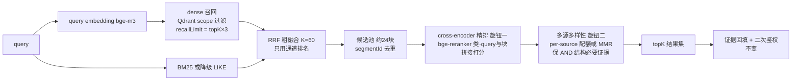

# 检索精排与多源覆盖设计

状态：`draft`
最后复核：2026-10-17

本页是 BR-04"关键跨视频题必要证据找不齐"的方案设计，**尚未实施**。现行检索行为见 [当前后端架构](../系统架构与技术流程.md) 与 [后端服务知识卡](后端服务维护.md)；基线数字见 [真实证据基准](真实证据基准-2026-10-08.md)。实施须按 [评测研究流程](评测研究流程-2026-10-15.md) 一次一旋钮验证。

## 问题：为什么必要证据找不齐（机制诊断）

冻结开发集上 dense 89.5%、RRF 68.4%、关键跨视频题未达标。四个结构性原因，前三个是精度问题，**第四个是跨视频题特有的组合问题**：

1. **RRF 丢弃了分数**。融合分 = Σ 1/(60+通道内排名)，两路原始分（余弦 0~1 与 BM25 无界分量级不可比）只用排名参与。免调参是优点，上限是区分不了"两路都排第 3 但都很弱"与"都很强"。
2. **固定阈值一刀切**。`min-vector-score=0.45` 对术语精确题合理，对语义概括题整体分数偏低时误杀弱相关但必要的块。
3. **bi-encoder 无交互**。bge-m3 把 query 和块独立编码、最后内积；query 与文档的词级-语义级交互没有发生。cross-encoder 精排在公开检索基准上的重排增益正是来自这一点。
4. **纯相关性排序压制多源覆盖**。requiredEvidence 是 AND 结构：一道跨视频题要求 A、B 两个来源的块**同时**进入 topK 结果集；而按相关性排序，与问题最像的视频 A 的多个块会霸榜（topK=5~8 全给 A），视频 B 的必要块排在第 6~10 名进不来。这是**结果集组合问题，不是精度问题——只上 reranker 不够，必须配多样性约束**。

## 目标架构（两阶段检索 + 多样性）

## 旋钮拆分（每轮只动一个）

| 旋钮 | 内容 | 观测指标 | 风险 |
| --- | --- | --- | --- |
| 一：rerank 开关 | 召回候选全量过 cross-encoder，重排取 topK；先混合通道候选，也可单通道 | dev 集 requiredEvidenceRecall@8、allEvidence、MRR；30 题金标不回退 | P95 延迟增加（API 批量约数百毫秒级，以实测为准）；弱相关块分数压不过强相关时无增益 |
| 二：多源多样性 | per-source 配额（每来源最多 N 条）或 MMR（惩罚与已选结果相似的候选） | 关键跨视频题（AND 结构）单独分层通过率 | 配额过强伤单视频精确题——分层看，不许平均分掩盖 |
| 三：自适应阈值 | 固定 0.45 改为 per-query（如按本次 top1 分数比例）或取消阈值靠排序 | 概括类问题召回变化 | 口径变化须进 manifest |
| 四：query 改写（可选） | 口语/错字容错改写后再召回 | 术语题 BM25 通道命中 | 先不动；改动面在查询侧之外 |
| 五：索引粒度对照（候选） | legacy segment 粒度 vs V11 块粒度同条件对照 | RRF 的 allEvidence 与关键题分层 | 2026-10-17 产品库复跑（legacy 粒度，[报告](../../eval/reports/evidence-baseline-dev-20261017.json)）显示 hybrid all 100% vs V11 块口径 84.6%、dense 单路 89.5% vs 94.7%——细粒度利融合多源、粗块利 dense 单路；单次小样本，须按 V11 口径重建索引复验后才能定论 |

## 成本与部署

精排**只改查询侧**：零入库成本、零存储变化、不动已 READY 索引、feature 开关可随时回退。候选 ~24 块一次批量调用；模型选型 bge-reranker 类（与 bge-m3 同家族、多语中文可用），本地部署（CPU 可跑）或经现有模型网关 API 均可，实施时按当时报价与 P95 实测定。与 Milvus dense 迁移在应用层解耦，互不阻塞，可先行。

## 评测与验收

- 基线：冻结开发集现有 dense 89.5% / RRF 68.4% @8 是对照组；每旋钮保存 manifest（rerank 模型、候选数、开关状态、git SHA）。
- 关键判定：**关键跨视频题分层通过率**（不是总分）；单视频精确题不回退；30 题与 3 演示视频案例回归。
- holdout 只终评一次；门禁沿 evidence-golden 内嵌 gates。

## 边界（本设计不解决什么）

ASR 错字导致的词法漏召回（旋钮四范畴）；结论语义正确性（BR-06，精排保证"找得对"不保证"答得对"）；Milvus dense 迁移（独立轨道）；已发布索引的任何重写。
