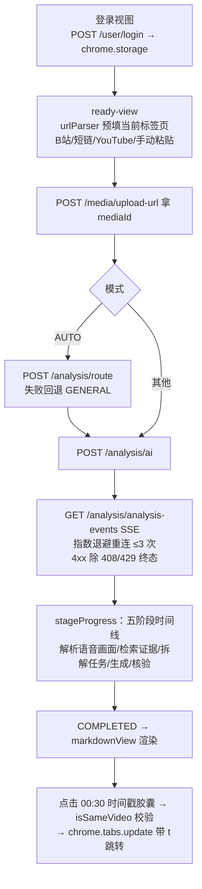

# extension 组件知识卡

状态：`active`
最后复核：2026-10-15

接到 extension（浏览器插件）任务时先读本页。改版设计历史见 [extension-sidepanel-design.md](浏览器侧边栏设计.md)（2026-09-10，已落地）。

## 职责与边界

Chrome MV3 扩展 "DoVideoAI"（v0.1.0），原生 JavaScript ESM，无构建、无依赖、无 TS。职责单一：在视频页打开侧边栏，预填链接提交 AI 分析，看进度与结果，点时间戳跳回视频。**连接的是 server（`lib/config.js` 的 `API_BASE = http://127.0.0.1:9090`），不涉及 mcp-server（9091）**。无 content script；`background.js` 仅设置点击图标开侧边栏。

## 提交流

安全实现：markdown 渲染全程 `createElement`/`textContent` 不碰 `innerHTML`（自写 `lib/markdown.js`/`markdownView.js`）；401（非 /user/ 路径）自动清 token 回登录视图。

## 选型与约束（含被否方案）

| 决策 | 现行选择 | 为什么 / 被否方案 |
| --- | --- | --- |
| MV3 权限 | `tabs/sidePanel/storage` + host_permissions 127.0.0.1:9090 | 绕过 CORS，后端零改动；被否：宽 host 权限（最小化） |
| SSE 重连 | 指数退避最多 3 次（client 是 ≤15s 无限退避） | 侧边栏场景用户在场，重试 3 次后应显式失败 |
| Markdown | 自写安全渲染器 | 被否：引入 marked——扩展侧进一步收紧（client 用 marked+白名单，扩展零依赖） |
| 范围边界 | 不做分片上传本地文件、不做追问 | README 明确"骨架版"指范围窄而非设计稿；单轮分析即闭环 |

**已知分歧**：扩展仍为暗色荧光绿（`color-scheme: dark`），client 已按 2026-10-15 DESIGN.md 转浅色；统一方向待定（改扩展或保持差异）。

## 修改历史（git 摘要，提取日 2026-10-15）

- 2026-09-10 a3aa5d7：打包为 Chrome 插件，网页快速使用。
- 2026-09-28 d2fa261：进度阶段对齐后端 + CI 覆盖（5 个 node:test）。
- 2026-09-29 98708e0：上传恢复与异步 UX 加固联动。

合并 PR 时在本节追加一行。

## 待办（见活跃队列）

视觉与 client 统一决策；b23.tv 短链时间戳跳转（现在不支持，无法还原视频 ID）；README 手动验收清单随行为变化同步。

## 文字版端到端测试案例

1. **B 站全流程**：在 B 站视频页打开侧边栏，链接自动预填，提交 GENERAL 分析，五阶段推进到 COMPLETED，结果含 `[mm:ss]` 胶囊，点击后当前标签页跳到对应时间。
2. **登录过期**：清掉 server 侧会话后提交分析，扩展应回登录视图而非报错堆栈；重新登录后无需重开浏览器。
3. **链接识别**：依次在 B 站/b23.tv 短链/YouTube watch/非视频页打开侧边栏，前三种自动预填，最后一种出手动粘贴框；b23.tv 分析完成后时间戳胶囊点击应提示不支持跳转。
