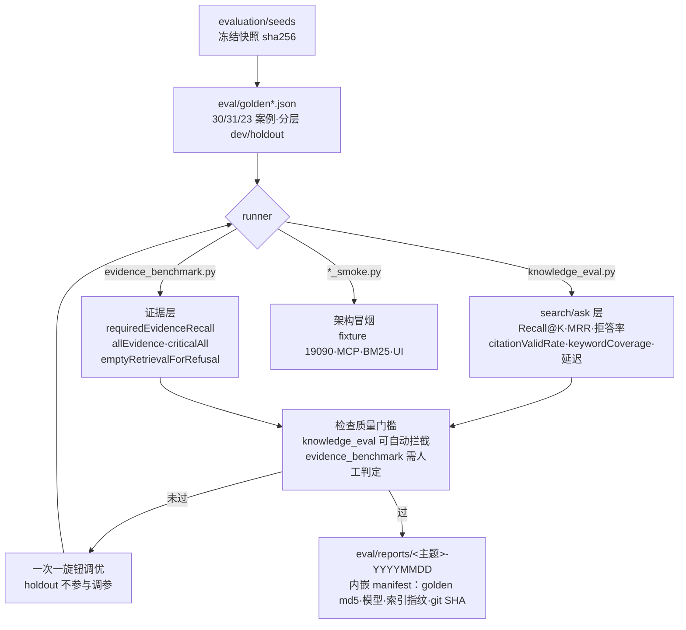
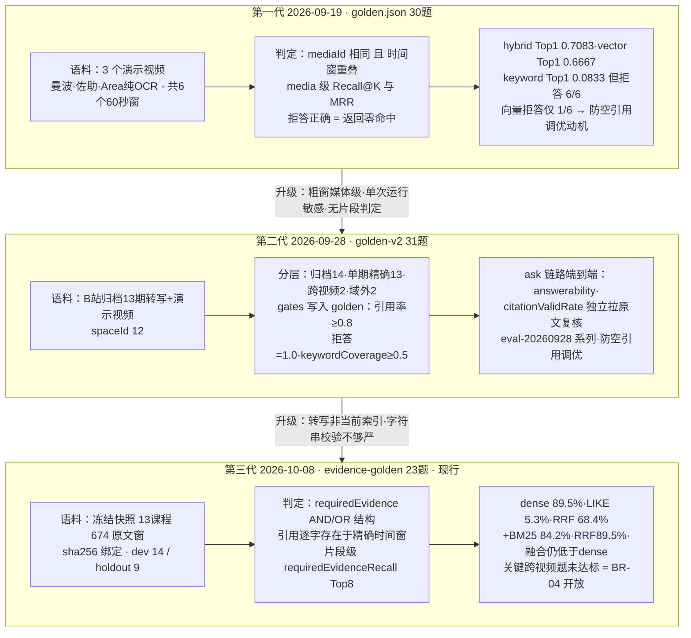

# eval 组件知识卡（含 evaluation/）

状态：`active`
最后复核：2026-10-16

先读[测试集构建与评测说明](../测试集构建与评测说明.md)理解数据来源与口径；接到评测代码维护任务时再读本页。指标口径的主文档是 [真实证据基准](真实证据基准-2026-10-08.md)；评测研究流程图见 [评测研究流程](评测研究流程-2026-10-15.md)。

## 职责与边界

两个目录分工：

- `evaluation/`：**冻结的数据资产**（无代码）。`seeds/bilibili-mianshi-v1.json`（归档语料 13 视频）与 `seeds/course-index-snapshot-v1.json`（当前索引原文快照，13 门课 674 个时间窗，2026-10-08 从独立索引副本导出，未重跑提取）。
- `eval/`：**活动评测资产**。golden 数据、Python runner、报告、冒烟脚本。现行 evidence golden 与语料经 sha256 绑定（`corpus.path` + 校验），语料变动即拒绝评测。

## 评测体系

指标定义在 `eval/evidence_metrics.py` 的 `summarize()`（代码即口径，无独立 METRICS 文件）；分三层——search 层（Recall@K/MRR/零命中拒答/延迟）、ask 层（answerability/citationValidRate 独立拉原文复核/keywordCoverage/延迟）、证据层（requiredEvidenceRecall 等）。

## 评测集演进（三代 golden 与各自测法）

项目简介中的"30 条 golden、hybrid Recall@1 0.7083 / 纯向量 0.6667"来自**第一代**（2026-09-19，`eval/golden.json` + `eval/results-20260919-*.json` 四份单次运行）；当前跨视频严格评测是**第三代**。引用数字必须注明代际，不得跨代比较。

第一代读数须知：24 条可答样本下 1 条 = 4.17 个百分点，0.7083 与 0.6667 仅差一条命中，四份 results 是四次运行四组数字（vector@1 在 0.625~0.6667 间波动）；时间窗 60 秒粗粒度、命中判到媒体不到片段——这就是"限定条件下的对比"的含义。第一代在 [当前交付状态](../当前交付状态.md) 的"历史质量证据"节降级保留；引用时必须带限定语。JUnit 单测（server 46 个测试类）保障代码回归，与三代线上评测互补：单测不证明检索质量，golden 不证明代码无回归。

**2026-10-17 复跑记录（口径警告）**：[evidence-baseline-dev-20261017.json](../../eval/reports/evidence-baseline-dev-20261017.json) 在产品库快照上复跑 dev 集，得 vector 89.5% / BM25 84.2% / hybrid **100%**（all 100%、关键题 1/1）。但产品库 13 源是 09-28 旧代码重建的 **legacy 索引（674 窗、0 检索块）**，与 10-08/09 正式基线的 V11 块索引（592 块）**粒度不同、不可比**。本轮观测：旧时间窗粒度下 RRF 多源覆盖读数更高（块粒度 hybrid all 84.6% → segment 粒度 100%），而 dense 单路略降（94.7%→89.5%）——仅提示待验证的解释，不能证明 [检索精排设计](检索精排与多源覆盖设计-2026-10-17.md) 的机制四（粗块霸榜压制多源覆盖），提示**索引粒度本身是一个待对照的旋钮**（小样本单次运行，待按 V11 口径重建索引后复验）。快照容器数据曾被 /tmp 清理，本次从产品库 mysqldump + Qdrant 文件复制重建（在线操作，未停产品服务）。

## 评测与验收边界

离线开发门禁与线上产品效果分开记录，不能合成一个“质量分”。当前可复现的离线事实以[真实证据基准](真实证据基准-2026-10-08.md)和对应 JSON 报告为准；下表中的“待补”是验收设计，不是已运行指标。

| 层 | 当前可检查的事实 | 待补验收 |
| --- | --- | --- |
| 接入与恢复 | 架构冒烟、任务状态和版本发布案例 | 真视频批量、MQ 中断、长任务重启、删除/重建对账；记录吞吐与成本 |
| 检索与证据 | 固定语料的必要证据 Recall、allEvidence、criticalAll；原文/时间戳回链 | OCR/代码精确词、音画冲突、长视频干扰、跨视频全部来源覆盖与 reranker 对照 |
| 问答与 Agent | 单轮答案的 answerability、引用逐字存在性、拒答案例 | 结论是否真的被证据支持、错时间戳/提示注入、计划覆盖、Critic 拦截、修订收益、预算与 checkpoint 恢复 |
| 线上体验 | Web/MCP 接入与页面操作可做手工走查 | 真实导入→提问→打开引用→采纳/纠错→再次使用的事件和用户反馈；按版本看成功率、P95 与成本 |

变更检索 profile、chunk、embedding、reranker、索引 schema 或问答链路时，先锁定语料/问题/模型/索引版本，跑 dev 对照并留 manifest；关键 sentinel 退化不得被平均值掩盖。holdout 只作最终评价。RAGAS 可作为以后回答质量的一层候选工具，但当前仓库未完成 RAGAS runner，不能把它写成已通过的门禁。文字案例由执行者准备环境，只有运行产物和失败记录才构成证据。

## Runtime（scripts/ 归并）

`scripts/architecture-fixture.sh`（隔离 fixture 19090）、`evidence-benchmark-runtime.sh`（19092、独立 Redis DB12、关 outbox）、`milvus-benchmark-runtime.sh`（Milvus 19531、collection `evidence_bm25_20261009`）、`mcp_e2e_client.py`（MCP 端到端验收）、`check-doc-links.mjs`（文档链接 CI）。凭据走 `KB_EVAL_TOKEN` / `KB_EVAL_USERNAME/PASSWORD`。CI 只跑 `test_evidence_metrics.py`（离线单测，不调付费模型）。

## 选型与约束（含被否方案）

| 决策 | 现行选择 | 为什么 / 被否方案 |
| --- | --- | --- |
| runner 依赖 | Python 3 标准库零依赖 | 任何机器可跑，无 venv 负担；被否：引入 ragas/框架（当时口径无法自控） |
| 语料冻结 | 快照 + sha256 拒绝运行 | 被否：直接打线上库评测——数字不可复现，调参失去基线 |
| 分层 | dev/holdout 显式 split，holdout 不参与调参 | 防评测集过拟合；golden-v2 又按任务分层（归档/单期/跨视频/域外拒答） |
| citationValidRate | harness 独立拉 segment 原文复核引用 | 被否：采信模型自述的引用 |
| 在线/离线 | 离线指标可单测，在线打真实服务 | 指标函数离线在线共用同一实现（evidence_metrics.py） |
| 报告 | 版本化目录 + manifest，不覆盖旧口径 | 不同 golden 不得当同数据 A/B |

## 修改历史（git 摘要，提取日 2026-10-15）

- 2026-09-19：召回策略阈值调参中间报告保留（e5ea127、cdfe847）。
- 2026-09-28 0512681：分层 golden + gates + 防空引用调参 + UI 走查证据。
- 2026-10-08 133b175（PR#2）：真实课程证据基准冻结与严格覆盖基线；evaluation/ 快照入库。
- 2026-10-08/09：evidence-block、query-scope、milvus-bm25（dev/mcp/smoke/ui）系列报告；cb939bd 增加 Milvus 部署与 benchmark 脚本 CI。

合并 PR 时在本节追加一行。

## 待办（见活跃队列）

BR-08：问答质量、容量、模型成本与混合负载故障实验；reranker 对照（BR-04 联动）；评测研究流程图（draft）中标注的 M2 待办项。

## 文字版端到端测试案例

1. **语料漂移防护**：改动 `evaluation/seeds/course-index-snapshot-v1.json` 任一字节后跑 `evidence_benchmark.py`，应在校验阶段报错退出，不产出报告。
2. **门禁拦截**：用低于 gate 的配置（如调高 min-vector-score 致 Recall 跌破 0.6）跑 golden-v2，进程应 exit 2 且报告记录违规指标。
3. **holdout 纪律**：dev split 上调参得到报告后，同一参数跑 holdout 只评估一次；两次以上 holdout 结果不得用于选型结论。
4. **冒烟独立性**：跑 `architecture_smoke.py` 期间停掉开发用 server，冒烟应仍能完成（fixture 自带 19090 运行时），证明不依赖手工环境。
5. **跨视频必要证据**：对标有两个以上必需片段的题目，分别记录 source 命中、requiredEvidenceRecall 与 allEvidence；只命中一个来源时不得判为通过。
6. **Agent 错引拦截（待建设）**：给草稿注入真实片段但错误结论、错误时间戳和无关来源；确定性 verifier 应拒绝错锚点，语义支撑另行评测，不以逐字匹配代替。
7. **完整用户旅程（待验收）**：用一条获准使用的真实视频，从导入、READY、提问、打开引用回看，到纠错/再次查询，记录每步实际结果与主体、语料和版本；不可拿合成数据的冒烟截图代替。
