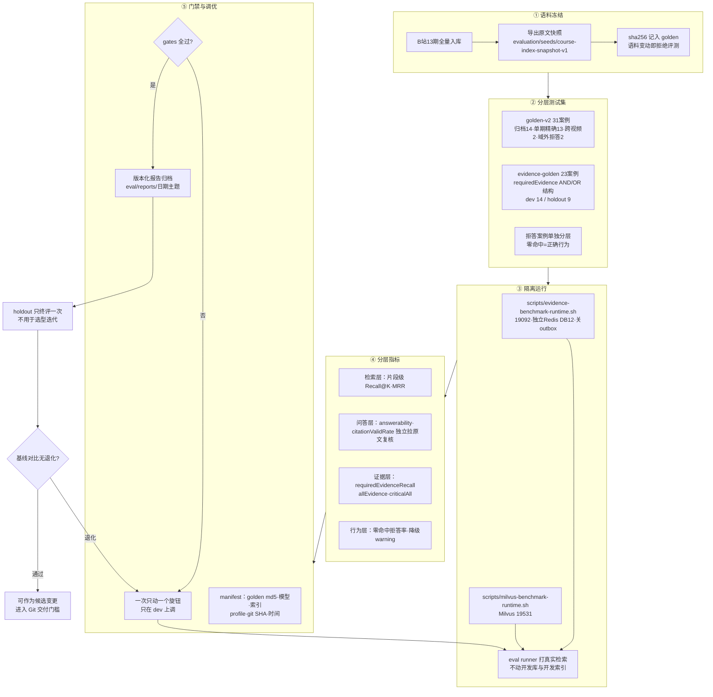

# 评测研究流程

状态：`draft`
最后复核：2026-10-15

本页用一张图讲清 VideoKB 的 RAG 评测研究闭环：语料怎么冻结、测试集怎么分层、指标怎么算、门禁怎么拦、调优怎么不作弊。评测资产与复现命令见 [eval 组件知识卡](评测体系维护.md)；指标口径与已冻结基线数字见 [真实证据基准](真实证据基准-2026-10-08.md)。本页是流程约定，不复制数字。

## 研究闭环

## 关键纪律（为什么这样画）

- **冻结先于评测**：调参期间语料动了，所有历史数字作废——所以第一步是快照 + sha256，不是跑分。
- **分层先于平均**：跨视频/术语精确/拒答分开看；一个总分掩盖"关键题全军覆没"（dev 基线曾出现 dense 89.5% 但关键跨视频题未找全）。
- **holdout 不参与调参**：dev 上旋钮可以转多次，holdout 每组参数只终评一次，否则评测集本身被过拟合。
- **citationValidRate 独立复核**：引用是否真在原文时间窗内逐字存在，由 harness 拉回 segment 原文核对，不采信模型自述。
- **一次一旋钮**：同时改切块+模型+融合参数的"提升"无法归因；每轮 manifest 记录唯一变量。
- **报告即证据链**：达标不是记在聊天里，是 `eval/reports/` 下带 manifest 的版本化文件，PR 合并时链接进对应文档。

## 与现状的差距（M2 待办）

- reranker 对照与融合权重调优尚未跑（BR-04 联动）。
- 问答层 keywordCoverage/延迟已有，模型成本与混合负载容量指标未纳入 manifest。
- golden-v2 的 ask 模式正式报告与 evidence 基线的统一视图待补。
- 评测通过后进入 [Git 交付门槛](../../agent.md) 的衔接（报告链接进 CURRENT/知识卡）已约定，待首次实操验证。
