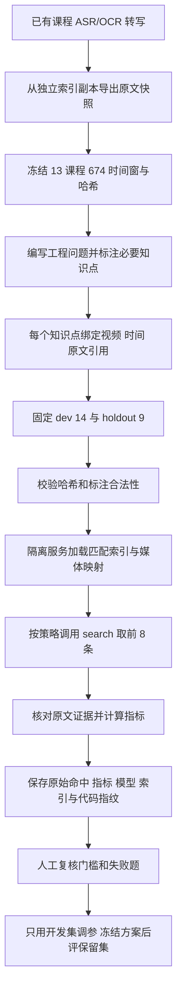

# 测试集构建与评测说明

状态：`active`
最后复核：2026-10-17

返回 [总索引](总索引.md)。本页负责解释测试数据从哪里来、如何标注、如何计分、现有结果能说明什么；详细历史和运行环境见[真实证据基准](专题资料/真实证据基准-2026-10-08.md)，脚本维护见[评测体系维护](专题资料/评测体系维护.md)。

## 先回答：我们的测试集是怎么做的

现行严格证据测试集不是自动抓取的用户问题库，而是依据真实课程转写编写的工程题。先冻结已有索引里的原文，再为问题标出必须找到的知识点、来源视频、准确起止时间及原文引用，最后把题目拆成开发集与保留集。仓库记录说明是工程编题，但没有逐题标注者身份、是否用 AI 辅助生成、独立复核人的记录；不能声称经过多人盲审或来自真实学生访谈。

| 资产 | 当前事实 | 直接核查位置 |
| --- | --- | --- |
| 原始归档 | 13 期课程转写资产 | [归档语料](../evaluation/seeds/bilibili-mianshi-v1.json) |
| 当前冻结语料 | 13 门课程、674 个 ASR/OCR 原文时间窗；2026-10-08 从独立索引副本导出，没有重跑提取 | [原文快照](../evaluation/seeds/course-index-snapshot-v1.json)、[导出脚本](../eval/export_snapshot_corpus.py) |
| 与旧归档差异 | 23 个窗口文字修订，时间边界未改变 | [修订清单](../eval/reports/corpus-revision-20261008.json) |
| 现行题集 | 23 题：20 可答、3 域外拒答 | [题目与标注](../eval/evidence-golden-v1.json) |
| 开发集 | 14 题：13 可答、1 拒答；其中 1 道关键题 | 同上，`split=dev` |
| 保留集 | 9 题：7 可答、2 拒答；其中 1 道关键题；不用于调参 | 同上，`split=holdout` |
| 数据冻结 | 题集绑定原文文件的 SHA-256，内容变化会报错 | [校验与计分代码](../eval/evidence_metrics.py) |

本次整理实际调用了 `validate_golden`，确认哈希、题目 ID、分组、标签及全部引用锚点合法。它检查文本和时间映射，不证明题目具有代表性或答案在语义上完整正确。

## 从语料到测试结果的完整流程



这里的证据评测只调用检索接口，没有调用回答模型，也没有从视频重新执行 ASR/OCR。视频提取质量、问答质量、网页体验和基础设施故障恢复分别需要其他验收。

## 一道题怎样标答案

开发题 `tcp-close` 问：“为什么 TCP 关闭连接需要四次挥手？TIME_WAIT 为什么要等待？”标注了两个必要知识点：

1. “全双工”：视频 `bili-mianshi-01` 的 1980000–2040000 毫秒，即 33:00–34:00。
2. “重发”：同视频的 2040000–2100000 毫秒，即 34:00–35:00。

每个知识点的 `alternatives` 可放多个等价原文锚点，任意一个命中即可；多个 `requiredEvidence` 知识点必须全部命中。只找到第一个知识点，该题必要证据覆盖为 1/2，整题全覆盖为失败。命中同一视频的无关片段不算成功。

计分要求来源匹配、时间窗起止完全匹配、标注引用存在于返回原文中；文本先做 Unicode NFKC、大小写、空白和标点归一化。因此它不是字节级逐字相等。新检索块通过 `evidence` 数组映射回原文窗，旧索引直接用时间窗；摘要不能充当原文。原始转写错误仍保留，不偷偷改写成理想文本。

## 三代测试集不能混着报数字

| 测试集 | 数量 | 测什么 | 限制 |
| --- | --- | --- | --- |
| [第一代](../eval/golden.json) | 30 题 | 演示资料的来源与时间重叠召回、MRR 等 | 小演示集；旧 Top1 数字不是现行课程效果 |
| [第二代](../eval/golden-v2.json) | 31 题 | 来源召回、回答、引用文本存在性、拒答 | 不能代表全部必要知识点覆盖或结论正确 |
| [现行证据集](../eval/evidence-golden-v1.json) | 23 题 | 前 8 条是否包含全部必要原文证据 | 仅检索；样本小，课程集中在技术面试类 |

单元测试检查代码边界，架构冒烟检查接口与任务流，证据评测检查固定语料召回。这三者不能互相替代。完整测试工具分工见[评测体系维护](专题资料/评测体系维护.md)。

## 指标到底怎么算、怎么判通过

| 指标 | 算法 | 不代表什么 |
| --- | --- | --- |
| requiredEvidenceRecall@8 | 所有可答题找回的必要知识点数 ÷ 必要知识点总数；不是逐题平均 | 不是回答准确率 |
| allEvidenceRate@8 | 找全所有必要知识点的可答题数 ÷ 可答题数 | 不是只命中一个视频就通过 |
| criticalAllEvidenceRate@8 | 关键题中找全的题数 ÷ 关键题数 | 开发集关键题只有 1 道，不能推导泛化 |
| emptyRetrievalForRefusalRate | 域外题返回零条结果的比例 | 不是模型拒答正确率 |
| P50/P95 | 本次请求耗时分位数 | 不是生产负载或公平的冷热缓存对照 |

现行题集写了必要证据召回 ≥ 0.8、关键题全覆盖 = 1.0 的门槛。**但 `evidence_benchmark.py` 当前没有读取 gates 并自动据此返回失败码：它保存报告后正常结束。需要人工复核指标；“脚本退出成功”不等于“质量验收通过”。** 第二代 `knowledge_eval.py` 的门禁逻辑不能套用到这支脚本。自动门禁缺口应在后续评测工程中修复，本次文档整理未改产品或评测行为。

## 现有报告说明了什么

以下全部是开发集必要证据 Recall@8；各行条件不同，不能跨行直接当严格 A/B。

| 报告与索引 | dense | LIKE | BM25 | 混合 | 混合关键题全覆盖 |
| --- | --- | --- | --- | --- | --- |
| [10-08 旧索引基线](../eval/reports/evidence-baseline-dev-20261008.json) | 89.5% | 5.3% | 未测 | 68.4% | 0% |
| [10-08 原文边界分块](../eval/reports/evidence-block-dev-20261008.json) | 94.7% | 15.8% | 未测 | 78.9% | 0% |
| [10-09 同批 592 块](../eval/reports/milvus-bm25-dev-20261009.json) | 94.7% | 15.8% | 84.2% | 89.5% | 0% |
| [10-17 旧粒度复跑](../eval/reports/evidence-baseline-dev-20261017.json) | 89.5% | 未单列 | 84.2% | 100% | 100% |

10-09 混合平均召回虽超过 0.8，但关键题失败，所以不能称达标。10-17 是 674 窗旧粒度运行，不能代替 592 块新版索引验收，也不能据此认定已证明分块粒度是唯一原因。它只提示应做同条件粒度对照；正式跨视频验收仍开放。

## 怎样复现与扩充

先按[真实证据基准的隔离步骤](专题资料/真实证据基准-2026-10-08.md#复现与保护)准备独立服务、匹配的索引及映射；旧报告里的端口不代表服务现在可用。凭据通过环境变量提供。仓库根目录执行：

```bash
python3 -m unittest discover -s eval -p 'test_evidence_*.py'
python3 eval/evidence_benchmark.py --base-url http://127.0.0.1:19092 --corpus-map eval/reports/evidence-baseline-map-20261008.json --split dev --output eval/reports/新一轮开发集报告.json
```

映射必须与本次隔离环境实际的媒体和索引版本一致，不能盲用旧映射。每轮使用新的报告名，保留模型、索引 profile、语料哈希和代码指纹。保留集仅在方案冻结后显式运行，不把结果反复拿来调参。

扩充时，先明确场景与来源，再增加语料版本和问题版本、标注必要证据与拒答题、复核锚点并预先固定分组，最后跑旧基线和新方案。待补的是逐题作者/复核记录、非技术课程覆盖、真实用户问题与独立语义判分；这些都不能用当前 23 题假装已完成。
