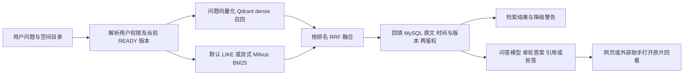
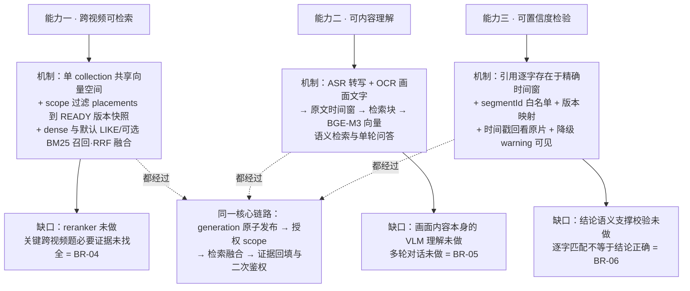
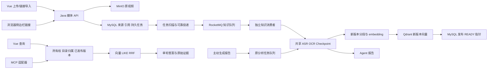

# 系统架构与技术流程

状态：`active`
最后复核：2026-10-17

本页解释当前代码的模块关系与不变量。交付程度和测试数字以 [当前交付状态](当前交付状态.md) 为准；长期目标见 [目标架构](专题资料/目标架构.md)，原 9 月断链现场见 [历史审计](历史归档/后端架构审计-2026-09-28.md)。当前工作区结构不同于当时运行服务，不能沿用旧图作为现状。

## 先看全局：三条链路怎样衔接

从用户视角，系统先把视频变成可以回看的原文证据，再检索证据，最后生成带来源的答案。上传、入库、检索、问答和单视频报告不是同一个完成状态。

| 链路 | 输入 → 处理 → 输出 | 最重要的失败边界 | 代码定位 |
| --- | --- | --- | --- |
| 视频入库 | 文件/链接 → 存媒体与持久任务 → MQ → ASR/OCR → 原文窗与检索块 → embedding → 发布 READY | 上传成功只代表受理；失败重建保留旧 READY | 下文“向量化究竟发生在哪里” |
| 跨视频问答 | 问题与目录范围 → 授权 → dense/词法召回 → RRF → 原文回填 → 单轮回答与引用 | 空结果、降级和拒答要区分；引用存在不等于结论正确 | 下文“检索、问答与库选型” |
| 单视频报告 | 主动分析请求 → 共享提取 → Agent 计划/执行/检查 → 报告 | 报告失败不应撤销已入库内容；不是多轮知识库会话 | [智能体工作流维护](专题资料/智能体工作流维护.md) |

默认技术组合是 Java/Spring Boot + Vue，MySQL 保存业务状态与原文，MinIO 保存媒体，RocketMQ 投递任务，Qdrant 保存 dense 向量。默认词法是 MySQL LIKE；显式启用后可用 Milvus BM25。Redis 承担相关缓存/协调职责，具体配置查[后端维护](专题资料/后端服务维护.md)。

RRF 是融合排名，尚无 reranker 精排。Milvus 的可选词法能力不等于 dense 已迁移。后续方案见[目标架构](专题资料/目标架构.md)，当前质量如何测见[测试集构建与评测说明](测试集构建与评测说明.md)。

## 三个产品能力的现行支撑与缺口

"跨视频可检索、可内容理解、可置信度检验"三个产品表述对应的系统机制与未闭合缺口：

## 业务怎样对应系统

通用效率型视频知识库需要让用户导入资料、按任务组织、查证原文并在 Web 或外部 Agent 中复用；学生复习是首批验证场景。对应的后端核心对象是：内容、归属、任务、已发布版本、授权查询；可选报告是内容的派生产物。产品定位与实际交付状态分别以 [agent.md](../agent.md) 和 [当前交付状态](当前交付状态.md) 为准。

| 边界 | 权威数据或模块 | 负责的事情 |
| --- | --- | --- |
| 内容身份 | MySQL `knowledge_sources`、`media_files` | 同用户媒体去重、来源身份与内容状态 |
| 目录归属 | `knowledge_placements`、空间/目录服务 | 同一内容多处引用；移动或解除某一处 |
| 任务受理/投递 | `knowledge_ingest_jobs`、`KnowledgeIngestJobService` | job 兼任 outbox，投递失败仍留持久记录 |
| 知识处理 | `KnowledgeIngestConsumer/Pipeline` | 独立知识队列、尝试/心跳、提取与索引 |
| 可复用提取 | `VideoPreparationService`、Checkpoint | 共享 ASR/OCR 内容准备，避免报告与入库重复提取 |
| 索引构建/发布 | `KnowledgeSegmentIndexService`、`KnowledgeIndexPublisher` | 新版本分段/embedding/向量写入完成后发布 |
| 授权范围 | `KnowledgeScopeResolver/QueryScope` | owner、placement、目录子树、READY/current version |
| 检索/回答 | `KnowledgeSearchService`、既有问答生成器 | dense/LIKE 或可选 Milvus BM25/RRF；回填证据、降级提示与单轮回答 |
| 外部接入 | Java `mcp-server` 经 Knowledge API | 五个只读工具；复用后端范围与权限规则 |

## 当前数据流

图中报告与知识任务共用提取服务，但各自有状态和队列。两者共享进程、资源、Checkpoint 与锁，不能称为完全独立的资源隔离。

链接导入先由媒体层用 yt-dlp 下载；平台要求登录验证或来源不可用时，当前工作区的未提交改动将失败分类映射为 503 和可操作的中文提示，知识任务不会因此变成 READY。此处是工作区代码状态，正式交付与验证仍以 [当前交付状态](当前交付状态.md) 的证据为准。组件分支和文字验收案例见 [server 知识卡](专题资料/后端服务维护.md)。

## 向量化究竟发生在哪里

上传接口完成文件接收、媒体/来源与持久知识任务受理，不等待模型处理。任务扫描器在事务提交后投递 jobId；知识消费者读取任务、调用内容准备，再进入 `indexMedia`。分段后批量调用 embedding，写新 generation 的 Qdrant 点，最后事务发布 MySQL 当前版本。

因此上传成功不等于向量化完成，job 是处理进度，来源 READY 是知识可用。显式重建任务的 `force_rebuild` 区分用户请求与重复投递；已发布内容遇到普通重复消息会跳过。旧转写导入入口仍直接复用相同索引服务，不能说所有资料类型都经过视频 MQ。

持久 job 状态是 QUEUED/PROCESSING/READY/FAILED/CANCELLED；stage 辅助显示提取与索引。自动尝试次数有限，心跳与失联恢复在代码中存在；真实长视频和服务重启仍需专项测试。配置与默认值见 [本次实现报告](专题资料/知识生命周期实现-2026-10-07.md)。

## 一个视频怎样放在两个文件夹

一份 `source` 对应多条 `placement(sourceId, spaceId, collectionId)`，位置唯一约束使重复添加幂等。目录不是向量索引的独立副本：

- “同时归入”添加 placement，媒体、转写、分段、embedding 都复用。
- 普通拖动移动指定 placement；Alt/Option 拖动添加引用。
- “移除此处引用”只解除选中的位置；最后一个引用不能直接解除。
- 真正删除视频撤销来源和任务，其他归属也失效。
- 创建空文件夹不产生知识；添加引用后其内容会进入该目录的授权检索范围。

旧 `spaceId/collectionId` 字段保留为主归属投影，旧 location 接口仍操作主位置。新查询使用 placements，避免移动目录后依赖过期 Qdrant 位置 payload。完整匹配路径展示与独立内容副本尚未提供。

## 动态更新与版本发布

新 generation 独立保存分段与向量。构建成功后 `KnowledgeIndexPublisher` 锁定 source 并在事务内设置版本 READY 与当前指针；删除或更新指针冲突不得发布。失败标记本次构建，不破坏旧 READY。

查询开始解析已发布版本快照，向量与词法都限定同一范围；回填核对 source/version。返回前再检查所有权、有效归属和删除状态，版本发布期间仍使用本次查询快照，避免命中突然被清空。

当前可靠发布覆盖索引重建与转写生成的新索引。目录 CHANGED 文件仍删除旧资产后再创建，不是完整安全文件替换；旧 generation 没有垃圾回收。已保留 READY 原文版本可通过 versionId 授权读取；资产替换、持久会话引用与清理的一致性仍需后续验证。

## 检索、问答与库选型

`KnowledgeVectorIndex` 是查询侧抽象，目前由 Qdrant 实现；写入侧仍绑定 Qdrant。过滤到授权 source 与 generation 后召回，默认词法为 MySQL LIKE，显式启用 Milvus 后 keyword 改用原生 BM25，hybrid 并行召回并做 RRF；缺回灌/数据丢失/请求失败会携带 warnings 降级为 LIKE。向量不可用时可保留词法结果，不表示模型问答或所有模式都不会失败。

Milvus 原生 BM25 词法通道已有本地实现与真实集对照，reranker 尚未实现；RRF 只融合候选排序。保留 Qdrant 是维持已验证基线的当前行为，不说明它在所有负载下优于 Milvus。2026-10-09 负责人指定 Milvus 为后续优先技术栈；迁移前在同一语料、切块、embedding、query 和授权过滤条件下对照，切换需双写、回灌、影子查询、权限/版本对账与回退验证。写入接口抽象与迁移尚未完成。

Milvus 的现行 BM25 写入、回执、查询与降级，以及未来 dense 迁移阶段见 [Milvus 专项架构图](专题资料/向量库架构与迁移边界.md)。

当前单轮问答沿用既有证据与拒答生成。引用字符串校验不能证明结论语义正确；原文 ID/版本/时间已映射并回归，结论语义校验、多轮对话和混合检索的全部必要来源覆盖仍待完成。

## MCP 是否必要

知识库解决内容组织、更新和查询；MCP 解决外部学习助手如何发现并调用同一能力，两者分属不同层。网页直接调用 API，MCP 不应另建一套索引或权限逻辑。

五个只读工具及参数见 [MCP SOP](外部助手接入指南.md)。目录工具返回引用与入库状态；search 可指定空间和目录，按 segmentId 去重。省略空间时 search 与 ask 均由后端选择默认空间；目录需要显式空间。`/search/details` 与 MCP 检索返回 scope/hits/warnings 区分准备状态，旧 `/search` 保留数组。所有 MCP 客户端使用同一个配置的上游主体，不适合直接宣称已实现社区成员隔离。

## 工程观测与源码入口

入库、query embedding、向量/词法召回和融合有有限标签的计时与失败事件，指标不包含用户或问题文本。Actuator 默认仅 health；显式暴露指标后只允许管理员身份。health 不等于完整模型/MQ/向量/媒体链路健康。

实现入口：

- [持久任务/投递](../server/src/main/java/com/example/server/service/KnowledgeIngestJobService.java)、[消费者](../server/src/main/java/com/example/server/consumer/KnowledgeIngestConsumer.java)、[入库管线](../server/src/main/java/com/example/server/service/KnowledgeIngestPipeline.java)。
- [目录引用](../server/src/main/java/com/example/server/service/KnowledgePlacementService.java)、[安全发布](../server/src/main/java/com/example/server/service/KnowledgeIndexPublisher.java)。
- [查询范围](../server/src/main/java/com/example/server/service/KnowledgeScopeResolver.java)、[混合检索](../server/src/main/java/com/example/server/service/KnowledgeSearchService.java)。
- [Vue 工作台](../client/src/KnowledgeLibrary.vue)、[MCP 分发](../mcp-server/src/main/java/com/example/mcp/server/McpDispatcher.java)。

原 9 月审计的断链来源、数据库现场与改进建议保留在 archive，不作为当前服务状态。完整剩余工作见 [活跃队列](待办事项.md)。

## V11 证据索引（2026-10-08）

默认 profile 不再依赖五分钟摘要生成；直接保存原始 ASR/OCR 时间窗，另建边界检索块和块到原文映射，再复用或生成 BGE 向量、写 Qdrant，全部成功后发布 generation。旧算法通过 legacy-v1 对照。检索回填 evidence 数组，问答引用原文 ID/版本/时间，历史 READY 版本可授权读取。默认词法仍 LIKE，可显式启用 Milvus BM25；结论级语义核验尚未完成。详细现行字段与实测见 [原文与检索块分离](专题资料/原文与检索块分离-2026-10-08.md)。

## 可选词法索引（2026-10-09）

`MilvusLexicalClient` 提供 BM25 collection/schema/index 参数校验、原文 upsert、Strong count 与范围查询；`KnowledgeLexicalIndexService` 管理 V12 完成回执和当前版本词法回灌。新 generation 的可选词法写入位于 dense 写入之后、SQL 发布之前。查询时检查全部授权版本的回灌完整性，失败整路降级并携带 warnings；原文回填继续由 SQL 再次授权。Qdrant dense 写入没有抽象成任意库可替换，Milvus dense/影子查询/垃圾清理仍待后续迁移。详见 [实现与真实集对照](专题资料/词法召回与对照-2026-10-09.md)。
